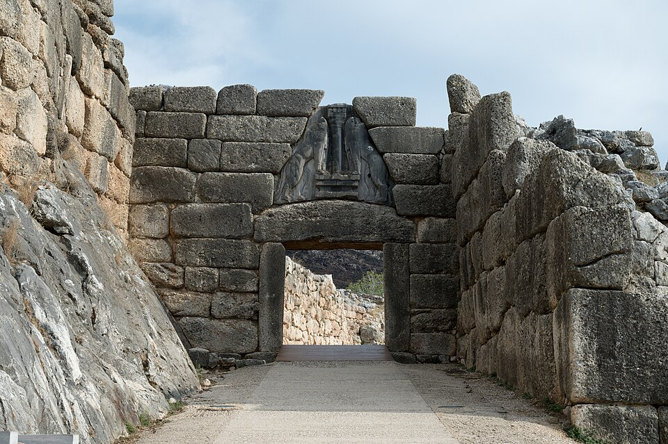

# Mycènes — citadelle, palais et mémoire des Atrides

*Dossier historique MYTHOS · Corpus grec · Source rédactionnelle : document « Mycènes » conservé sur Google Drive (septembre 2026).*

**Méthode.** Le dossier distingue les vestiges archéologiques, les hypothèses des chercheurs et la tradition mythique des Atrides. Les dates sont indicatives lorsqu’elles relèvent de la chronologie archéologique. Le nom traditionnel « tombeau d’Agamemnon » ne prouve pas l’existence de ce personnage historique.

Mycènes est l’un des sites fondamentaux pour comprendre la Grèce : ici, on quitte la Grèce classique d’Athènes ou de Sparte pour remonter à l’âge du Bronze, plusieurs siècles avant Homère. C’est cette civilisation, florissante surtout entre environ 1600 et 1100 av. J.-C., que les archéologues ont appelée « mycénienne » d’après le nom de Mycènes. Le site est inscrit au patrimoine mondial de l’UNESCO avec Tirynthe.

## Mycènes : géographie, chronologie et pouvoir

Mycènes occupe une position remarquable : la citadelle contrôle les routes de l’Argolide depuis un éperon situé entre deux montagnes. Cette position permettait de surveiller la plaine d’Argos et les communications terrestres. Le site est occupé dès le Néolithique, mais sa transformation en grand centre politique commence véritablement au XVIIe siècle av. J.-C.

### L’émergence des élites : les cercles funéraires

Vers 1700 av. J.-C., une première aristocratie puissante apparaît. Elle enterre ses morts dans les tombes à fosse du Cercle funéraire B. Puis, vers 1600 av. J.-C., apparaît le fameux Cercle funéraire A, où des personnages de rang très élevé sont inhumés avec des quantités extraordinaires d’or, d’armes, de bijoux et d’objets importés. Ces découvertes révèlent déjà des contacts avec la Crète minoenne et d’autres régions de la Méditerranée.

C’est dans le Cercle A que Heinrich Schliemann fouille en 1876 et découvre les célèbres masques funéraires en or. Il croit avoir retrouvé les tombes d’Agamemnon et de ses compagnons. Le célèbre « masque d’Agamemnon » porte encore ce nom, mais la tombe est plusieurs siècles trop ancienne pour correspondre à un éventuel souverain contemporain de la guerre de Troie traditionnellement placée vers 1200 av. J.-C.

### Les palais, le wanax et l’écriture linéaire B

À partir du XVe siècle av. J.-C., la civilisation mycénienne devient la puissance dominante de la Grèce continentale. Les palais administrent des territoires organisés autour d’un souverain appelé en linéaire B le wanax. Cette administration connaît l’écriture : le linéaire B, déchiffré au XXe siècle, transcrit une forme très ancienne de grec. C’est donc déjà un monde grec, bien antérieur à l’alphabet grec.

Mycènes atteint son apogée approximativement entre 1350 et 1200 av. J.-C. Le palais monumental est installé au sommet de la citadelle ; les fortifications cyclopéennes sont construites et agrandies en plusieurs phases vers 1350, 1250 et 1225 av. J.-C. Les blocs sont tellement gigantesques que les Grecs des siècles postérieurs attribuèrent leur construction aux Cyclopes.

### La Porte des Lionnes et la mémoire des ancêtres

Vers 1250 av. J.-C., la citadelle est considérablement remaniée. C’est notamment l’époque de la célèbre Porte des Lionnes. Son triangle de décharge est occupé par deux félins dressés de part et d’autre d’une colonne. Il s’agit d’une véritable architecture de pouvoir : le visiteur qui pénétrait dans la citadelle devait immédiatement comprendre qu’il entrait dans le centre d’une autorité royale.

Le Cercle funéraire A, alors vieux de plusieurs siècles, est intégré à l’intérieur des nouvelles murailles. C’est très révélateur : les rois mycéniens du XIIIe siècle semblent avoir voulu monumentaliser leurs ancêtres et utiliser leur mémoire pour légitimer leur propre pouvoir.

### Le palais et le mégaron

Au sommet se trouvait le palais royal. Son centre était le mégaron : porche, vestibule puis grande salle comportant un foyer central entouré de colonnes et le trône du souverain. Cette forme architecturale connaîtra une postérité considérable dans l’architecture grecque. Autour se trouvaient magasins, ateliers, bâtiments religieux et résidences d’officiels.

### Les tombes à tholos et le « Trésor d’Atrée »

À l’extérieur de la citadelle se trouvaient les grandes tombes royales à tholos, à coupole en encorbellement. Leur évolution culmine avec le spectaculaire Trésor d'Atrée, construit probablement au XIIIe siècle av. J.-C. Son nom est moderne : nous ignorons qui y fut réellement enterré. Il est aussi traditionnellement appelé « tombeau d’Agamemnon », sans preuve archéologique permettant cette identification.

Il s’agit d’une distinction historique fondamentale : l’archéologie prouve l’existence d’une très puissante monarchie mycénienne, mais elle ne prouve pas qu’Agamemnon ait réellement régné ici.

## Les Atrides : le mythe face à l’archéologie

La mémoire mythique est pourtant fondamentale. Dans la tradition grecque, Mycènes devient le royaume des Atrides : Atrée et Thyeste, puis Agamemnon et Ménélas. Agamemnon dirige l’expédition achéenne contre Troie ; il sacrifie ou accepte le sacrifice d’Iphigénie selon les versions ; puis, à son retour de Troie, il est assassiné par Clytemnestre et Égisthe. Oreste vengera ensuite son père en tuant sa propre mère. De cette matière mythique naîtront notamment l’Orestie d’Eschyle, les Électre de Sophocle et d’Euripide et l’Iphigénie à Aulis d’Euripide. L’UNESCO souligne précisément l’association exceptionnelle de Mycènes avec les traditions homériques.

## Des destructions à la mémoire historique

Autour de 1200 av. J.-C., le système palatial mycénien s'effondre dans le cadre de la grande crise de la fin de l’âge du Bronze. Mycènes subit destructions et incendies ; le site survit un temps mais perd définitivement son statut de capitale palatiale et est en grande partie abandonné vers 1100 av. J.-C.

Mycènes reste néanmoins habitée modestement. À l’époque archaïque, un sanctuaire est construit sur l’ancienne acropole. La ville participe aux guerres médiques ; puis Argos conquiert et détruit Mycènes en 468 av. J.-C. À l’époque romaine, le site est déjà une ruine célèbre que viennent contempler les voyageurs, notamment Pausanias au IIe siècle apr. J.-C.

Ce site superpose plusieurs niveaux historiques et mémoriels : Mycènes historique de l’âge du Bronze → effondrement → Mycènes transformée en lieu de mémoire → Mycènes mythique d’Agamemnon et des Atrides.

## Comprendre les différents niveaux de preuve

| Archéologie attestée | Mémoire et tradition ultérieures |
| --- | --- |
| Fortifications, porte monumentale, palais, mégaron et tombes royales. | Récit d’Atrée, Thyeste, Agamemnon, Clytemnestre et Oreste. |
| Documents en linéaire B attestant une langue grecque mycénienne et une administration palatiale. | Épopées homériques et dramaturgie des époques archaïque et classique. |
| Transformations du site et destructions de la fin de l’âge du Bronze. | Attribution légendaire des murailles aux Cyclopes et des tombes aux Atrides. |

## Parcours de lecture MYTHOS

- [L’Égée à l’âge du Bronze : civilisations minoenne et mycénienne](/bibliotheque-mythologies-du-monde/civilisations-histoire-egee-bronze/).
- [Les tragédies grecques : Eschyle, Sophocle, Euripide](/tragedies/).
- [Les analyses philosophiques : justice, faute, vengeance et souveraineté](/philosophie/).
- [L’encyclopédie grecque](/grece/).

## Sources et contrôle philologique à poursuivre

Pour compléter cette synthèse : consulter la notice UNESCO du site de Mycènes et de Tirynthe, *Pausanias*, **Description de la Grèce**, livre II, les éditions de tablettes en linéaire B et les rapports archéologiques des fouilles du site. Aucun récit d’Homère ou des tragiques ne doit être présenté comme le compte rendu direct d’un événement historique de l’époque palatiale.

*Cette page reprend la partie historique d’un document Google Drive ; le parcours pratique, les horaires et les tarifs datés ne sont pas reproduits ici. Le document original reste conservé sur Drive.*
