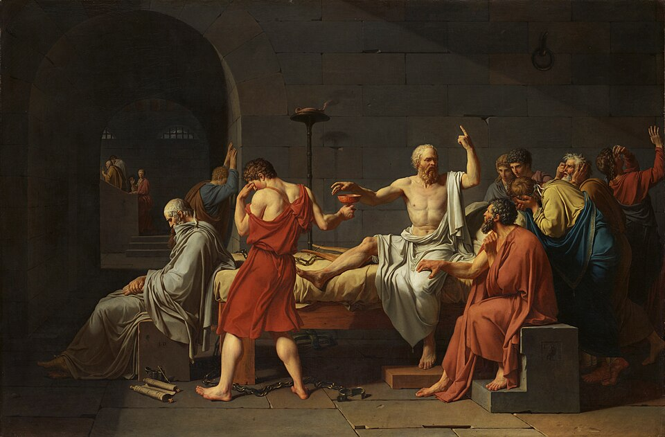

# Socrate, l’oracle de Delphes et le paradoxe de la sagesse

**Cote indépendante : PHY-SOC-2026-01 · Collection : Philosophie antique · 30 octobre 2026.**

**Édition intégrale de lecture**, reconstituée à partir du mémoire de 30 pages. Le document original se présente comme une rédaction universitaire de recherche **non soumise à validation académique** ; ses traductions antiques sont signalées comme traductions de travail. Ces précautions éditoriales sont reproduites intégralement ci-dessous.

[Lire le mémoire original intégral en PDF (30 pages)](/assets/philosophie/socrate-oracle-delphes-paradoxe-sagesse-2026.pdf) · [Bibliothèque de philosophie](/philosophie/) · [Grande encyclopédie](/grande-encyclopedie/).

**Sommaire :** les six parties, la conclusion, la bibliographie commentée et les quatre annexes sont accessibles dans le sommaire de lecture généré sur cette page, sans suppression d'aucune section de l'original.

## Transcription intégrale du mémoire source

SOCRATE, L’ORACLE DE DELPHES ET LE
PARADOXE DE LA SAGESSE
De l’ignorance reconnue à l’exigence d’une vie examinée
Mémoire de synthèse et de recherche en philosophie antique — rédaction intégrale révisée
Édition de lecture mobile • 30 octobre 2026

## RÉSUMÉ

Selon l’Apologie de Platon, Chéréphon aurait demandé à la Pythie s’il existait quelqu’un de plus
sage que Socrate ; la réponse, qu’aucun homme ne lui était supérieur en sagesse, ouvre un
paradoxe. Comment un homme qui refuse de s’attribuer un savoir exceptionnel peut-il être présenté
comme exemplaire ? La présente étude défend une interprétation différenciée : dans le récit
platonicien, la sagesse ne réside ni dans une ignorance absolue ni dans la possession d’un savoir
encyclopédique, mais dans un rapport réglé à ses affirmations, qui distingue compétence,
réputation et prétention injustifiée à savoir. Cette interprétation est confrontée aux témoignages de
Xénophon et d’Aristophane, au fonctionnement de la réfutation, aux exigences éthiques de la vie
examinée et aux tensions politiques que révèlent l’Apologie et le Criton. La tragédie grecque et la
critique de Nietzsche constituent ensuite un contrepoint : une vie rationnellement examinée
échappe-t-elle pour autant au conflit, au malheur et à l’opacité de l’action ? L’étude conclut que le
paradigme socratique gagne à être compris comme une discipline faillible de responsabilité
intellectuelle, mais qu’il ne suffit pas, sans réflexion sur le jugement pratique et sur les limites de la
rationalité, à constituer une philosophie complète de l’existence.

## MOTS-CLÉS : Socrate ; oracle de Delphes ; Apollon ; Platon ; Xénophon ; elenchos ; ignorance

socratique ; sophia ; justice ; Criton ; tragédie grecque ; Nietzsche.

## PRÉCAUTIONS ÉDITORIALES

Le document qui suit constitue une rédaction intégrale nouvelle, reconstruite dans le cadre du plan
initial du mémoire. Il ne reproduit pas littéralement la version Word du 27 octobre 2026. Les
passages antiques sont référencés par les divisions canoniques ; les traductions françaises
originales données dans le texte sont des traductions de travail, à confronter à l’édition scientifique
retenue avant tout dépôt universitaire. Chaque fois qu’il y a lieu, les affirmations sont distinguées
selon leur statut : texte attesté, reconstruction historique, hypothèse interprétative. Le présent
manuscrit n’est pas présenté comme une recherche universitaire déjà validée.

## SOMMAIRE

Introduction — Problématique, hypothèses, sources et méthodeI. La construction historique et religieuse du problème
socratique

## II. Le récit de l’oracle : enquête, réfutation et limites du savoir

## III. L’ignorance socratique comme exigence morale

## IV. De la sagesse à la cité : procès, lois et désobéissance

## V. Socrate, la tragédie et la contestation nietzschéenne

## VI. Discussion critique : que vaut la sagesse de Socrate ?

Conclusion générale
Bibliographie commentée et ressources
Annexe I — Repères chronologiques
Annexe II — Lexique grec
Annexe III — Parcours de lecture et questions de recherche
Annexe IV — Statut des affirmations et méthode de citation

## INTRODUCTION — PROBLÉMATIQUE, HYPOTHÈSES, SOURCES ET MÉTHODE

En 399 avant notre ère, Socrate est condamné à mort à Athènes. Les témoignages disponibles lui
attribuent des conversations qui ébranlent la confiance des hommes dans leurs propres
connaissances ; pourtant, aucun écrit de sa main ne nous est parvenu. La difficulté n’est pas
simplement de savoir ce que l’homme Socrate aurait enseigné. Elle est de déterminer comment une
figure, progressivement élaborée par les textes de ses contemporains et de ses successeurs, est
devenue le modèle d’une philosophie attentive aux conditions de la vérité, de la vertu et de la
justice. Le contraste entre son absence d’œuvre écrite et l’abondance de sa postérité éclaire
d’emblée la nature du problème : Socrate est un objet d’histoire, mais aussi un personnage littéraire
et une construction conceptuelle.

L’Apologie de Platon attribue à Chéréphon une consultation de l’oracle de Delphes. À la question de
savoir si quelqu’un est plus sage que Socrate, la Pythie aurait répondu par la négative (20e–21a).

Ce récit ne doit pas être lu comme une transcription retrouvée des archives du sanctuaire. Nous
disposons de narrations philosophiques, dont celle de Xénophon, qui en rapporte une variante
significative. Il reste cependant légitime de s’interroger sur la signification interne du paradoxe :
comment une parole divine peut-elle désigner comme sage un homme qui se dit dépourvu de la
sagesse qu’on lui prête ? Et quel type de vie devient possible lorsque l’on cesse de confondre ce
que l’on croit avec ce que l’on sait ?Le problème est d’autant plus aigu que l’expression populaire « Je sais que je ne sais rien »
transforme parfois Socrate en partisan de l’ignorance universelle. Or la source décisive, Apologie,
21d, décrit quelque chose de plus précis : l’homme examiné croit savoir alors qu’il ne sait pas,
tandis que Socrate, dans la même situation, ne s’attribue pas le savoir absent. La différence porte
sur l’évaluation réflexive de ses propres raisons. Elle ne détruit pas l’utilité des connaissances
spécialisées. Le philosophe reconnaît d’ailleurs explicitement aux artisans des compétences qu’il
n’a pas (22c–e). Il faudrait donc parler moins de culte du non-savoir que d’une vigilance à l’égard
des prétentions intellectuelles.

Trois hypothèses organisent l’enquête. La première est épistémologique : la supériorité relative du
Socrate de l’Apologie tient à une forme de probité intellectuelle, c’est-à-dire à la capacité de refuser
une autorité non justifiée. La deuxième est éthique : cette probité s’étend à la manière de vivre,
puisque l’examen des affirmations devient interrogation sur les vertus, les désirs, le soin de l’âme et
la justice. La troisième est critique : une philosophie qui met l’accent sur la clarification rationnelle
peut sous-estimer la contingence de l’action, la vulnérabilité humaine ou l’expérience artistique ; la
tragédie et Nietzsche permettent d’en mesurer les tensions sans constituer, pour autant, une
réfutation globale de Socrate.

Il importe de ne pas traiter ces hypothèses comme des résultats historiques immédiatement acquis.

La phrase « nul n’est plus sage que Socrate » ne prouve pas qu’il soit le seul individu le plus sage :
sur le plan logique, elle n’exclut pas d’autres hommes égaux à lui selon le critère retenu. En outre,
le mot sophia ne correspond pas toujours à une seule conception stable de la sagesse. Selon les
usages, il peut renvoyer à une compétence, à un jugement, à un art de vivre ou à une autorité
intellectuelle. La recherche doit donc demeurer attentive aux contextes d’énonciation.

La méthode combine quatre opérations. D’abord, une lecture suivie des passages de l’Apologie, du
Criton et de plusieurs dialogues de Platon, avec repérage de la pagination Stephanus. Ensuite, une
confrontation des traditions platonicienne et xénophontique, sans présupposer que leurs
divergences puissent être effacées au nom d’un Socrate historique parfaitement reconstituable.

Troisièmement, l’analyse de questions philosophiques transversales : conditions de la réfutation,
savoir moral, devoir civique et connaissance pratique. Enfin, un examen comparatif de Sophocle,
d’Euripide, d’Aristote et de Nietzsche, en distinguant systématiquement comparaison philosophique
et généalogie historique. La bibliographie secondaire sert à contrôler les thèses plutôt qu’à leur
conférer artificiellement une certitude.

## I. LA CONSTRUCTION HISTORIQUE ET RELIGIEUSE DU PROBLÈME SOCRATIQUE

### 1.1. Socrate et l’Athènes de la fin du Ve siècle

On situe traditionnellement la naissance de Socrate vers 469 av. J.-C. et sa mort en 399. Il traverse
une longue période pendant laquelle Athènes, après son expansion impériale et ses réalisations
culturelles, subit les épreuves de la guerre du Péloponnèse (431–404), la défaite face à Sparte, le
gouvernement oligarchique des Trente et la restauration démocratique de 403. Ces
bouleversements ne constituent pas le simple décor d’un drame individuel. Ils modifient lesconditions de la confiance civique, la définition de la compétence politique et le rapport entre
éducation, persuasion et loyauté envers la cité.

Athènes repose sur des institutions civiques dans lesquelles la parole joue un rôle important, sans
que toute la population participe également à la citoyenneté. L’Assemblée, le Conseil et les
tribunaux font de l’argumentation une pratique décisive, mais une pratique mêlée de compétition, de
réputation et d’intérêts. Demander à un homme influent de définir la justice ou le courage peut dès
lors devenir un geste politiquement sensible. La question socratique n’est pas seulement « que
sais-tu ? », mais « qu’est-ce qui autorise ta prétention à parler et à agir pour les autres ? ».

Il serait toutefois réducteur de décrire Socrate comme un simple opposant à la démocratie. Dans
l’Apologie, 32a–e, le personnage raconte son refus de participer à une procédure qu’il juge illégale
contre les stratèges après les Arginuses, puis son refus d’exécuter l’ordre des Trente visant Léon de
Salamine. Les deux cas impliquent des autorités politiques différentes. Ils servent à montrer que le
critère revendiqué est celui de la justice plutôt que celui d’une fidélité exclusive à un camp. Il faut
néanmoins distinguer ce témoignage que Platon prête à Socrate de la possibilité de reconstituer
avec certitude toutes les circonstances de chaque épisode.

Les chefs d’accusation rapportés sont eux aussi précis : ne pas reconnaître les dieux que reconnaît
la cité, introduire des nouveautés divines et corrompre les jeunes gens (Apologie, 24b–c). Les
relations du cercle socratique avec certains personnages compromis dans les violences politiques
appartiennent à l’arrière-plan possible du procès ; elles ne constituent pas une démonstration
causale suffisante du verdict. La méthode historique impose donc de maintenir séparés les chefs
d’accusation, le contexte de suspicion et les interprétations modernes des motivations des juges.

### 1.2. Les sources et le « problème socratique »

Le premier obstacle méthodologique vient de l’absence d’écrits authentiquement attribuables à
Socrate. La majeure partie de ce que nous savons de ses paroles, de ses convictions et de son
comportement nous parvient par des œuvres produites dans des genres différents. Aristophane
mobilise la caricature comique, Xénophon l’apologie morale et la remémoration exemplaire, Platon
le dialogue philosophique. Aristote, plus tard, formule des appréciations sur les recherches de
définitions et l’histoire des doctrines. Les œuvres de ces auteurs ne doivent pas être traitées
comme autant de dépositions convergentes portant sur des faits aisément isolables.

Dans Les Nuées, représentées pour la première fois en 423 av. J.-C., Aristophane met en scène un
Socrate associé aux spéculations naturelles et à l’apprentissage d’arguments trompeurs. Le texte
conservé est cependant une version remaniée de la comédie initiale, ce qui impose une prudence
supplémentaire dans l’utilisation de ses détails. La pièce nous renseigne avec force sur les
possibilités de représentation publique du philosophe ; elle ne fournit pas une biographie fiable de
son enseignement.

Xénophon, dans les Mémorables, l’Apologie et d’autres écrits socratiques, privilégie la piété, la
maîtrise de soi et les bénéfices pratiques de la fréquentation du philosophe. Platon construit des
dialogues où Socrate conduit ses interlocuteurs vers des difficultés définitionnelles, des
contradictions ou des hypothèses doctrinales nouvelles. Certaines thèses du personnage,
particulièrement dans des dialogues où se développent les Formes et la théorie de l’âme, ne
sauraient être attribuées au Socrate historique sans argumentation indépendante.La question n’est donc pas de choisir naïvement le témoin le plus favorable. Le « problème
socratique » désigne précisément l’impossibilité de passer directement des représentations
disponibles à une doctrine incontestablement professée par l’homme réel. La prudence n’impose
pas un scepticisme total : elle permet de travailler sur des objets définis, par exemple « le Socrate
de l’Apologie de Platon » ou « l’argumentation de Xénophon, Apologie, § 14 ». Cette précision
terminologique est une condition de rigueur, non un obstacle à la réflexion philosophique.

### 1.3. Delphes, Apollon et l’autorité de la parole oraculaire

Le sanctuaire d’Apollon à Delphes occupait une place majeure dans les pratiques religieuses
grecques. Des communautés et des particuliers s’y adressaient afin de solliciter une réponse divine,
formulée puis interprétée dans un cadre rituel. Les traditions anciennes présentent parfois les
oracles sous forme de sentences ambiguës ou énigmatiques, mais leur diversité historique interdit
de réduire l’ensemble de la divination delphique à un style littéraire unique. Une consultation
religieuse ne constitue pas une démonstration au sens d’une argumentation philosophique.

Le récit platonicien tire précisément sa force de cette différence. Socrate ne répond pas à l’oracle
par l’acceptation satisfaite de la supériorité qu’on lui attribue ; il le transforme en question. Le sens
de la réponse ne se trouve pas donné au premier regard. La parole divine, tenue pour véridique par
le personnage, appelle une vérification de ce que les hommes entendent par la sagesse. Le récit
introduit ainsi une tension féconde entre autorité religieuse et activité rationnelle : la recherche
n’abolit pas la parole du dieu, elle prétend en dégager la portée.

Les maximes traditionnellement associées à Delphes, notamment « Connais-toi toi-même » (gnôthi
seauton) et « Rien de trop » (mêden agan), peuvent être comparées à cette démarche. La
reconnaissance de la limite humaine et la méfiance envers l’excès présentent une parenté
thématique avec la sagesse du Socrate platonicien. Mais une analogie philosophique n’est pas une
preuve de filiation historique. Il n’est pas établi que l’ensemble de la méthode socratique dérive
directement de ces inscriptions ; une telle conclusion exigerait des preuves supplémentaires sur les
traditions de réception et leur chronologie.

### 1.4. Deux versions de l’oracle : Platon et Xénophon

Platon, Apologie, 21a, rapporte la question de Chéréphon sur l’existence éventuelle d’un homme
plus sage que Socrate. La Pythie aurait répondu que personne n’était plus sage. La formulation est
comparative : elle attribue à Socrate le fait de n’être surpassé par aucun autre selon le critère
invoqué. Elle n’affirme pas que sa sagesse serait omnisciente ni qu’aucun autre homme ne pourrait
lui être égal.

Chez Xénophon, Apologie, § 14, la réponse divine concerne trois qualités : la liberté, la justice et la
maîtrise de soi. Cette version oriente l’attention vers une conduite exemplaire, alors que l’Apologie
de Platon construit surtout l’énigme d’une sagesse qui paraît se nier elle-même. Les deux traditions
sont compatibles avec l’idée générale que Socrate bénéficie d’une reconnaissance divine
particulière, mais elles ne permettent pas d’établir les paroles exactes d’une consultation historique.

Une difficulté demeure : les témoignages pourraient partager une tradition commune sans
constituer deux confirmations indépendantes de tous les détails. L’historien doit donc suspendre le
jugement sur la formulation originelle. Le philosophe, en revanche, peut analyser les deux récitscomme deux choix de construction normative : chez Platon, la vérité des prétentions à savoir est au
premier plan ; chez Xénophon, la vertu et la conduite maîtrisée apparaissent comme critères de
distinction.

### 1.5. Une autorité paradoxale : religion, enquête et autonomie

On pourrait croire que toute légitimation religieuse condamne l’examen rationnel à n’être qu’une
obéissance. Pourtant, l’Apologie donne à voir un mouvement plus complexe. Socrate présente
comme devoir religieux une activité dont la forme consiste à interroger, à éprouver et à refuser les
certitudes infondées. Ce n’est pas une explication purement sécularisée de la philosophie : l’oracle
et le dieu restent importants dans l’auto-interprétation du personnage.

La difficulté critique est de savoir ce qu’autorise exactement la prémisse selon laquelle le dieu ne
saurait mentir. Pour un lecteur contemporain, elle ne découle pas d’une preuve indépendante et ne
peut servir de fondement partagé à tous les raisonnements. À l’intérieur du récit, elle met
néanmoins Socrate en mouvement : son ignorance présumée, confrontée à la réponse oraculaire,
suscite une enquête qui va produire des raisons accessibles à la discussion. Le paradoxe n’abolit
donc pas la rationalité ; il provoque un travail sur la différence entre une autorité revendiquée et la
justification des croyances.

En définitive, le problème historique prépare ici le problème philosophique. Nous ignorons la teneur
exacte d’une éventuelle parole oraculaire, mais nous pouvons étudier avec précision comment
Platon et Xénophon donnent sens à la figure d’un homme reconnu par le dieu tout en s’opposant
aux prétentions humaines à une sagesse excessive.

## II. LE RÉCIT DE L’ORACLE : ENQUÊTE, RÉFUTATION ET LIMITES DU SAVOIR

### 2.1. L’énigme d’une sagesse que Socrate ne reconnaît pas en lui

Dans l’Apologie, 20d–e, Socrate distingue une sagesse proprement humaine de connaissances
dont il refuse de se dire possesseur. Le récit de l’oracle, 21a–b, radicalise la difficulté : si aucun
homme n’est plus sage que lui, pourquoi n’a-t-il pas conscience de détenir un savoir supérieur ?

L’enjeu ne se confond pas avec un doute psychologique portant sur sa valeur personnelle. Deux
critères de jugement se heurtent : la réputation ou la désignation publique, d’une part ; la capacité à
justifier ses affirmations, d’autre part.

La réponse n’est pas immédiatement reformulée en une doctrine rassurante. Socrate rapporte une
période d’embarras avant de se mettre en quête d’un homme réputé sage. Il décrit sa démarche
comme une tentative de réfutation : il cherche quelqu’un qui serait plus sage que lui afin de mettre à
l’épreuve la portée de l’énoncé oraculaire. L’argument est remarquable parce qu’il transforme
l’autorité du dieu en un problème d’enquête humaine. Dans le cadre narratif platonicien, ce n’est
pas l’oracle qui démontre en détail ce qu’est la sagesse ; c’est la confrontation des prétentions
humaines au savoir qui conduit à une interprétation.On doit ici prendre garde à deux sophismes. Premièrement, l’absence d’homme plus sage ne
signifie pas que Socrate posséderait tous les savoirs techniques, artistiques ou politiques.

Deuxièmement, le fait que Socrate ne soit pas surpassé ne lui confère pas nécessairement une
supériorité exclusive, puisque plusieurs personnes peuvent être à égalité. Le paradoxe demeure
donc ouvert tant que l’on n’a pas précisé ce que l’on entend par sophia.

### 2.2. Première épreuve : les hommes politiques et la sagesse de

réputation
Socrate commence par se rendre auprès d’un homme politiquement influent, dont il tait le nom
(Apologie, 21b–d). Son constat porte sur la distance entre l’apparence de sagesse et la réalité d’une
justification. Aux yeux de ses concitoyens, l’homme paraît compétent ; il l’est surtout à ses propres
yeux. Mais l’entretien, selon le récit que Socrate en fait, ne confirme pas cette réputation. Le
philosophe conclut qu’il est plus sage sur un point limité : il ne croit pas connaître ce qu’il ne sait
pas.

Il serait injustifié de transformer cette scène en condamnation du savoir politique comme tel. La cité
connaît des compétences dans le commandement, la négociation et la délibération. Ce que Socrate
met en cause, c’est le passage non vérifié de l’efficacité publique à la possession de la justice ou du
bien. Réussir un discours devant l’Assemblée, recevoir une charge ou bénéficier d’une notoriété ne
démontre pas que l’on puisse définir les vertus nécessaires à leur juste exercice. L’argument révèle
ainsi une possible rupture entre succès social et autorité épistémique.

Le récit insiste aussi sur le ressentiment engendré par cet examen. L’interlocuteur humilié, comme
les témoins de la discussion, peut éprouver la réfutation comme une attaque personnelle. Socrate
devient impopulaire parce qu’il rend publique une insuffisance que les réputations sociales avaient
masquée. La pratique critique révèle ici une ambivalence politique : elle peut servir la vérité, mais
elle produit du conflit, surtout lorsqu’elle touche à l’honneur et au prestige.

La conclusion de 21d est néanmoins prudente. Socrate ne déclare pas qu’il sait toutes les choses
belles et bonnes. Il suppose plutôt qu’aucun des deux ne les connaît de façon suffisante, et que
celui qui s’abstient d’affirmer une connaissance absente possède un avantage réflexif. La sagesse
devient une capacité d’ajustement entre conviction et justification, non un capital infini de vérités.

### 2.3. Deuxième épreuve : les poètes, l’inspiration et l’autorité de

l’œuvre
La recherche se poursuit chez les poètes tragiques, les auteurs de dithyrambes et d’autres
créateurs (Apologie, 22a–c). Socrate ne nie pas leur excellence artistique. Il observe, dans son
propre récit, que certains ne sont pas capables de rendre raison du sens de leurs compositions
aussi bien qu’on pourrait s’y attendre. Il propose alors une analogie avec les devins et les
interprètes inspirés : la production de grandes œuvres peut dépendre d’une puissance que l’auteur
ne maîtrise pas sous forme de savoir explicite.

Cette analyse ne permet pas de conclure qu’aucune connaissance ne participe à la poésie. Les
compétences métriques, musicales, dramaturgiques ou linguistiques sont bien réelles. Ce qui est
mis en cause est l’inférence selon laquelle l’excellence dans un art conférerait automatiquementune compétence morale ou cosmologique universelle. On peut produire une représentation
puissante du courage sans posséder une théorie générale du courage ; on peut émouvoir en
représentant les dieux sans avoir une connaissance certaine de leur nature.

La critique de la poésie possède une portée particulière dans une culture où Homère, les poètes
lyriques et les tragiques constituent des références de formation et de transmission de valeurs.

Interroger le poète, ce n’est pas seulement interroger un artiste moderne au sens étroit ; c’est
éprouver une autorité culturelle et éducative. La philosophie ne s’oppose donc pas forcément aux
œuvres, mais elle refuse que leur prestige serve de dispense à l’argumentation.

Ce passage annonce une difficulté que Nietzsche reprendra sous une forme opposée. Si la création
ne se réduit pas à l’explication de ses propres raisons, doit-on considérer cette opacité comme une
déficience ou comme une dimension irréductible de l’expérience artistique ? L’Apologie privilégie la
critique des prétentions générales. La question de la valeur propre de l’inspiration demeure ouverte
et rend nécessaire le détour ultérieur par la tragédie.

### 2.4. Troisième épreuve : les artisans, la technê et les limites de

l’expertise
Les artisans fournissent le cas le plus important pour éviter de caricaturer Socrate en négateur de
toutes les connaissances. Il découvre auprès d’eux une compétence effective : ils savent produire
des choses qu’il serait incapable de produire (Apologie, 22c–e). Leur savoir possède une efficacité
identifiable, des procédures, une possibilité de contrôle par l’expérience et une transmission
possible. Socrate ne les rabaisse donc pas simplement au niveau des réputations politiques.

Le défaut apparaît lorsqu’une compétence locale devient le fondement illégitime d’une prétention
globale. Celui qui sait fabriquer un objet peut se croire autorisé à parler sans examen de justice, de
gouvernement ou de vertu. Le problème n’est pas la spécialisation ; c’est son extrapolation. Ainsi
comprise, la scène présente une distinction entre savoir situé et sagesse totale. La compétence
technique mérite une reconnaissance proportionnée à son domaine, non une délégation universelle
d’autorité.

Il faut remarquer que ce raisonnement est lui-même exigeant. Quelles frontières définissent
exactement un domaine ? Une compétence artisanale peut impliquer des jugements sur les fins, les
usages et les conséquences sociales de l’activité. L’argument socratique ne saurait donc devenir
une théorie rigide interdisant à tout expert de parler au-delà de sa spécialité. Il invite plutôt à
demander de nouvelles raisons lorsqu’on change de sujet et de critères.

Cette leçon possède un intérêt philosophique durable. Une personne peut être fiable pour certaines
questions et se tromper gravement lorsqu’elle étend indûment son prestige à d’autres. La réflexion
sur la sagesse exige de reconnaître à la fois le savoir positif et ses limites. Elle refuse deux
positions symétriques : la dévalorisation indifférenciée des experts et la transformation de
l’expertise sectorielle en privilège intellectuel illimité.

### 2.5. Le retournement interprétatif de l’oracle

Après ces trois étapes, Socrate énonce une hypothèse d’interprétation : la sagesse véritable
appartient au dieu, tandis que la sagesse humaine est de peu de valeur en comparaison (Apologie,23a–b). Le dieu aurait ainsi employé le nom de Socrate comme un exemple pour enseigner que le
plus sage est celui qui connaît le peu de valeur de sa propre prétention à la sagesse. Cette
conclusion appartient au personnage platonicien ; on ne doit pas la présenter comme la restitution
de l’intention historiquement vérifiable de la Pythie.

Le paradoxe est alors reformulé plutôt que purement supprimé. Socrate est exemplaire non parce
qu’il possède une doctrine complète, mais parce qu’il n’usurpe pas le statut de savant là où ses
raisons demeurent insuffisantes. La supériorité comparative n’est pas celle d’un catalogue de
réponses ; elle réside dans une meilleure orientation de l’attitude cognitive. Ce déplacement donne
au récit son efficacité philosophique : l’homme qui paraît ne rien posséder de remarquable devient
une mesure critique des prétentions les plus prestigieuses.

L’oracle fournit également au philosophe un motif de poursuivre les conversations. Socrate déclare
qu’il continue d’examiner citoyens et étrangers, au service du dieu, afin de rendre visibles les
réputations de sagesse infondées. L’enquête dépasse ainsi un épisode individuel et devient une
tâche durable. Elle n’a pas seulement pour conséquence la découverte d’un principe ; elle
détermine une pratique de vie qui engage du temps, des relations et des risques.

### 2.6. Peut-on conclure de la réfutation à l’ignorance ?

Une objection méthodologique apparaît dès cette première enquête. Démontrer qu’un homme ne
peut maintenir sans contradiction toutes ses déclarations ne prouve pas qu’il ignore absolument le
domaine dont il parle. Il se peut qu’une proposition périphérique soit erronée, que la formulation soit
maladroite ou que les exigences du dialogue ne permettent pas de restituer correctement une
compétence pratique. Le résultat logique immédiat est une incompatibilité au sein d’un ensemble
d’engagements discursifs ; la vérité de chacun n’en découle pas automatiquement.

L’elenchos ne doit donc pas être magnifié comme machine à produire directement des vérités
positives. Son bénéfice est d’exposer des insuffisances de justification, de défaire une confiance
prématurée et d’imposer un retour à la question. Si une contradiction apparaît, il faut entreprendre
une nouvelle enquête pour identifier l’erreur pertinente et reconstruire une position mieux fondée.

Ce travail peut échouer ou rester inachevé. Il n’en est pas pour autant vain.

La sagesse socratique exige ainsi deux qualités qui ne sont pas identiques : une capacité négative
de contrôle des prétentions, et une orientation positive vers la recherche des raisons les meilleures.

Une simple collection de réfutations pourrait nourrir le scepticisme stérile ou l’orgueil de celui qui
n’affirme rien tout en disqualifiant tous les autres. Le sens éthique du récit interdit cette conclusion
facile : Socrate cherche à amener ses interlocuteurs à mieux vivre, non seulement à les
embarrasser.

### 2.7. Première synthèse : la sagesse comme rapport véridique à soi

Les politiques, les poètes et les artisans incarnent trois figures distinctes de l’autorité : le prestige
civique, l’excellence créatrice et la maîtrise d’une technê. En les réunissant dans un même
itinéraire, l’Apologie distingue le fait d’accomplir quelque chose de remarquable et le fait d’être
capable de justifier universellement ce que l’on affirme. Les trois enquêtes ne nient pas les
différences entre les activités ; elles dévoilent le même risque d’extension injustifiée du savoir.La lecture défendue ici peut être appelée « probité épistémique », à condition de ne pas projeter
sans réserve un concept moderne dans le vocabulaire grec. Il s’agit de proportionner l’assurance
aux raisons disponibles, de reconnaître la compétence d’autrui là où elle s’exerce et de ne pas
confondre la réputation avec la vérité. Cette capacité est réflexive : elle porte sur le rapport que
l’agent entretient avec ses propres jugements. Mais elle reste pratique : elle doit transformer la
manière de discuter, de décider et d’habiter la cité. La prochaine partie examine cette extension
morale.

## III. L’IGNORANCE SOCRATIQUE COMME EXIGENCE MORALE

3.1. « Je sais que je ne sais rien » : une formule philosophiquement
équivoque
L’expression devenue célèbre « Je sais que je ne sais rien » résume de manière séduisante, mais
trop abrupte, l’attitude socratique. Elle ne figure pas textuellement sous cette forme dans l’Apologie.

Le passage 21d explique que Socrate ne s’attribue pas la connaissance des choses qu’il ignore, à
la différence de l’interlocuteur qui croit savoir sans savoir. La différence entre les deux hommes ne
suppose donc pas que Socrate détiendrait une connaissance propositionnelle exhaustive de son
ignorance ; elle concerne d’abord la manière dont il évalue la validité de ses propres jugements.

Cette distinction est mise en valeur dans l’étude de Gail Fine, « Does Socrates Claim to Know that
He Knows Nothing? » (2021, p. 33–62). La reconnaissance d’une insuffisance de sagesse peut être
distinguée d’une connaissance totale de l’absence de toute connaissance. Selon les nuances
considérées, Socrate sait qu’il n’est pas sage ou a conscience de ne pas l’être. Il n’est pas
nécessaire d’en faire un homme affirmant simultanément et contradictoirement que rien n’est connu
et que cette proposition serait connue.

Il importe aussi de distinguer plusieurs usages du verbe « savoir ». Dans un contexte, le savoir peut
signifier posséder une compétence professionnelle ; dans un autre, savoir ce qu’est la justice ou la
vertu ; dans un troisième, être capable de décrire fidèlement les limites de son jugement. Les
dialogues platoniciens ne présentent pas toujours ces usages comme rigoureusement identiques.

Faire de Socrate le défenseur d’une ignorance universelle reviendrait à effacer la reconnaissance
des savoirs des artisans et les convictions morales fermes que le personnage exprime ailleurs.

L’ignorance socratique apparaît donc ici comme une forme de discipline intellectuelle : suspendre
l’affirmation de ce qu’on n’est pas suffisamment fondé à soutenir. Mais cette discipline n’est pas une
invitation à la passivité. Elle crée une raison de demander des définitions, de comparer les
propositions, de reconnaître les erreurs et de poursuivre la formation du jugement. C’est pourquoi
l’ignorance reconnue peut devenir le commencement d’une existence philosophique.3.2. L’elenchos : examen, contradiction et responsabilité
argumentative
Le mot grec elenchos peut désigner la mise à l’épreuve, l’interrogation critique et la réfutation. Dans
plusieurs dialogues généralement associés à l’examen socratique, un interlocuteur avance une
définition, puis Socrate en explore les conséquences à partir d’autres propositions que le même
interlocuteur accepte. Si l’ensemble devient contradictoire, l’accord initial ne peut être maintenu
sans révision. La méthode ne consiste donc pas simplement à opposer une opinion rivale à une
opinion ; elle cherche à faire travailler les engagements internes du discours.

L’Euthyphron en fournit un exemple classique : la réflexion sur la piété met en question le rapport
entre ce qui est pieux et ce qui est aimé des dieux (10a–11b). Dans le Lachès, l’objet de recherche
est le courage ; dans le Charmide, la modération. Ces dialogues ne livrent pas nécessairement une
définition stable et finalement ratifiée. Ils révèlent l’étendue du travail restant à accomplir,
notamment lorsqu’une réponse familière se heurte à des cas difficiles.

Le statut de la réfutation demeure néanmoins contesté. Si quatre propositions sont conjointement
incohérentes, il ne suffit pas d’indiquer cette incohérence pour établir sans argument
supplémentaire laquelle est fausse. Le résultat est une obligation de réviser, non une démonstration
automatique de la thèse opposée. Le Socrate mis en scène peut tirer de ce résultat une conclusion
sur la prétention de son interlocuteur à la science ; mais le lecteur doit distinguer la portée logique
d’une incompatibilité de l’interprétation psychologique ou morale qui en est faite.

La méthode comporte encore une dimension relationnelle. L’interlocuteur est invité à répondre en
son nom et à reconnaître les conséquences de ses propres affirmations. La contradiction peut
produire de l’embarras, de la honte ou de l’irritation. Elle peut aussi libérer un espace d’examen
partagé, si les deux participants acceptent de chercher plutôt que de simplement vaincre.

L’elenchos est alors une forme de responsabilité argumentative : on ne peut invoquer indéfiniment
des formules prestigieuses lorsqu’on demeure incapable d’en répondre.

### 3.3. La définition de la vertu et l’intellectualisme moral

La recherche de définitions n’est pas une distraction purement linguistique. Demander ce qu’est le
courage suppose que les hommes agissent parfois avec courage et parfois avec témérité ;
demander ce qu’est la justice doit aider à distinguer un comportement équitable d’un avantage
injustement acquis. La connaissance recherchée est ainsi inséparable du problème de la conduite.

Le philosophe ne cherche pas seulement à ordonner des propositions : il cherche des raisons
capables d’orienter une existence.

Dans le Protagoras, 352b–358d, Platon fait examiner le rapport entre savoir, plaisir, mauvais calcul
et action. Le raisonnement dit intellectualiste soutient que celui qui possède réellement une
connaissance correcte de ce qui constitue son bien n’est pas simplement renversé par un plaisir
présent considéré indépendamment de ses conséquences. L’action mauvaise peut alors être
comprise à partir d’une erreur sur la valeur respective des choix. La thèse se distingue de l’idée
simpliste selon laquelle les hommes ne commettent jamais volontairement des actes dont ils
connaissent certaines conséquences négatives.

Une objection fondamentale concerne l’akrasia, que la tradition philosophique décrira comme
l’incapacité d’agir conformément à ce que l’on juge meilleur. Il arrive qu’une personne affirme savoirqu’une action lui nuit et l’accomplisse néanmoins. Faut-il en déduire que sa connaissance n’était
pas véritablement établie, ou reconnaître une autonomie partielle des désirs et des affects par
rapport au jugement ? Ces questions traversent l’éthique antique et donnent lieu à des réponses
différentes chez Platon et Aristote. Elles montrent que l’intellectualisme socratique est un problème
argumentatif plutôt qu’un dogme exempt de difficultés.

Il serait notamment excessif d’imputer à tous les dialogues de Platon une psychologie identique. La
manière dont les passions sont analysées évolue avec les dispositifs philosophiques. Dans le cadre
précis de notre enquête, l’important est que l’examen des raisons se présente comme une condition
du soin de soi, sans fournir à lui seul une psychologie exhaustive des motivations humaines.

### 3.4. Le soin de l’âme contre la priorité des honneurs

Dans l’Apologie, 29d–30b, Socrate oppose l’accumulation de richesse et le souci de la réputation à
une préoccupation plus fondamentale : prendre soin de l’âme et rechercher le meilleur état possible
de soi-même. Le soin de l’âme ne doit pas être projeté immédiatement dans une catégorie
psychologique moderne. Il désigne, dans le discours platonicien, l’attention à la qualité éthique et
intellectuelle de l’existence, à ce par quoi une personne peut être jugée juste ou injuste, bonne ou
mauvaise.

La critique des honneurs ne signifie pas que toute activité économique, familiale ou politique serait
sans valeur. Elle établit plutôt un ordre de priorité. Un bien extérieur peut être recherché, mais il ne
devrait pas dispenser d’évaluer la justice des moyens employés ni la qualité morale du résultat. Une
cité qui confond richesse, prestige et vertu risque de récompenser des réussites incapables de
répondre de leurs fins. La mission socratique vient réintroduire l’interrogation sur ce qui mérite
réellement d’être poursuivi.

La formule de l’Apologie, 38a, radicalise cette position : ὁ δὲ ἀνεξέταστος βίος οὐ βιωτὸς ἀνθρώπῳ.

On peut la rendre, à titre de traduction de travail, par « Une vie dépourvue d’examen ne mérite pas
d’être vécue pour un être humain ». L’énoncé n’est pas une mesure objective de la valeur des vies
d’autrui ni une justification de mépriser les personnes privées d’éducation philosophique. Dans le
contexte du plaidoyer, il exprime l’indissociabilité de l’existence de Socrate et d’une pratique
quotidienne de questionnement.

### 3.5. Ironie, asymétrie et difficultés de l’enseignement socratique

La posture de non-savoir peut cependant poser un problème. Celui qui multiplie les questions sans
annoncer ses propres thèses conserve une position avantageuse dans le dialogue : les propositions
de son interlocuteur sont exposées à la critique, tandis que ses propres critères restent parfois
moins visibles. Cette asymétrie peut être une stratégie de découverte, mais elle peut aussi devenir
une forme de domination discursive. D’où l’importance d’une question réflexive : le philosophe
accepte-t-il de soumettre à la même épreuve les principes dont il se sert pour réfuter les autres ?

L’ironie socratique ne se laisse pas réduire à une moquerie ni à une simple feinte d’ignorance.

Selon les textes et les interprétations, elle peut exprimer la reconnaissance authentique d’une limite,
une prudence pédagogique ou un décalage volontaire entre ce qui est déclaré et ce que
l’interlocuteur doit découvrir. Gregory Vlastos a largement contribué à étudier ces ambiguïtés. Il fautnéanmoins se garder d’en faire une méthode uniforme applicable sans différence à toutes les
conversations mises en scène par Platon.

Une pédagogie de l’examen doit rendre son partenaire plus responsable de ses propres raisons. Si
le dialogue ne produit qu’une humiliation, il risque d’échouer moralement alors même qu’il a révélé
une incohérence logique. Le mérite d’une pratique socratique ne peut donc être évalué uniquement
par le nombre de positions réfutées. Il dépend aussi de la possibilité d’une recherche partagée et de
la disposition du questionneur à se reconnaître lui-même faillible.

### 3.6. Une sagesse qui n’est jamais achevée

Le paradoxe de l’ignorance reconnue se transforme ainsi en conception pratique de la philosophie.

Il ne suffit pas d’avoir un jour identifié une erreur. Il faut conserver la capacité de réviser ses
convictions, de vérifier les autorités auxquelles on se fie et d’écouter les objections. Une vie
examinée n’est pas celle dans laquelle tous les problèmes seraient résolus, mais celle où les
croyances décisives ne seraient pas abandonnées à la simple habitude ou au prestige.

Cette conception possède un aspect moral essentiel : l’homme se doit d’éviter de commettre
l’injustice, y compris lorsque l’action injuste lui procurerait richesse, sécurité ou reconnaissance.

Pourtant, l’identification précise de la justice reste souvent disputée. La philosophie socratique
associe donc une orientation éthique ferme à une recherche conceptuelle inachevée. Cette
association constitue à la fois sa puissance et sa fragilité.

Le chapitre suivant examine le moment où ces deux dimensions se heurtent : quand la cité
commande, condamne ou menace, l’examen des raisons doit-il céder devant l’institution ? Le
procès et le refus de fuir obligent à demander si le souci de justice implique l’obéissance, la
désobéissance ou une distinction plus fine entre les deux.

## IV. DE LA SAGESSE À LA CITÉ : PROCÈS, LOIS ET DÉSOBÉISSANCE

### 4.1. La parole critique et les institutions athéniennes

Le procès de Socrate est devenu l’un des épisodes les plus commentés de l’histoire de la
philosophie, mais sa signification ne se réduit pas à un affrontement simple entre une vérité
individuelle et un pouvoir arbitraire. La condamnation prononcée dans une cité démocratique pose
des problèmes complexes de justice, de persuasion et d’autorité. Platon présente Socrate comme
un homme qui interroge les critères auxquels ses concitoyens accordent de la valeur. Il ne se
contente pas de désapprouver des comportements ; il demande aux citoyens de rendre compte de
ce qu’ils savent de la vertu et du bien.

Cette pratique est politique sans se confondre avec la lutte partisane. Dans une démocratie fondée
sur la délibération, toute critique des réputations de compétence peut avoir des conséquences
publiques. Si un homme politique ne peut définir la justice dont il prétend être le serviteur, la critique
philosophique atteint indirectement les mécanismes de légitimation de son pouvoir. Pourtant, lephilosophe n’est pas nécessairement détenteur d’un programme institutionnel alternatif. Son geste
consiste d’abord à éprouver les critères de la parole publique.

Les deux épisodes que Socrate évoque dans l’Apologie, 32a–e, illustrent cette position. Lors de
l’affaire des stratèges des Arginuses, il affirme avoir résisté à une procédure collective irrégulière.

Sous les Trente, il déclare avoir refusé l’ordre de prendre part à l’arrestation de Léon de Salamine.

L’un et l’autre récits font apparaître un refus de participer à ce qui est jugé injuste, mais ils relèvent
de configurations institutionnelles distinctes. Il serait abusif d’y voir la preuve d’une adhésion simple
à un parti ou à un régime.

Le procès de 399 s’inscrit dans une cité meurtrie par la guerre, la défaite et les violences politiques.

L’histoire critique doit cependant éviter d’en déduire une explication unique de la condamnation. Les
accusations formelles portent, telles que Platon les rapporte, sur l’impiété et la corruption des
jeunes gens (24b–c). Les tensions politiques ont pu contribuer à l’atmosphère du procès ; elles n’en
remplacent pas les éléments judiciaires attestés dans les sources narratives.

### 4.2. La mission divine et l’image du taon

Dans l’Apologie, 29d–30e, Socrate déclare qu’il ne renoncerait pas à philosopher même si les juges
lui proposaient l’acquittement à la condition qu’il se taise. Il obéirait au dieu plutôt qu’aux hommes,
selon le discours platonicien. L’affirmation place la mission philosophique au-dessus d’une exigence
hypothétique d’abandon de l’examen. Il ne s’agit pas seulement d’un trait de caractère courageux :
le personnage présente son activité critique comme un devoir plus important que la préservation de
sa propre sécurité.

L’image du taon, qui stimule un grand cheval noble mais lourd, condense cette conception (30e).

Socrate n’affirme pas qu’il gouverne la cité à la place de ses institutions. Il prétend lui rendre un
service en empêchant ses membres de s’endormir dans leurs certitudes. Cette fonction suppose
une position paradoxale : être utile à la communauté tout en étant accusé de troubler son ordre. La
philosophie est décrite comme une pratique de sollicitation morale, non comme la seule élaboration
de doctrines privées.

Il faut néanmoins distinguer la scène du plaidoyer d’une théorie générale de la désobéissance
civile. Le Socrate de Platon ne formule pas une règle selon laquelle tout individu peut ignorer toute
décision institutionnelle qui lui déplaît. Il soutient que certaines obligations éthiques et religieuses ne
sauraient être sacrifiées à l’avantage immédiat. La portée générale de ce principe exige un examen
de la justice de l’action envisagée : poursuivre une activité tenue pour juste n’est pas
automatiquement identique à violer toute loi contestée.

### 4.3. Le Criton et la question de la fuite

Après la condamnation, le Criton met en scène une rencontre entre Socrate et son ami qui lui
propose de s’évader. Criton fait valoir les possibilités pratiques de la fuite, le tort que sa mort
infligerait à ses proches, la réputation des amis restés inactifs et les obligations de Socrate envers
ses enfants. La discussion oppose donc plusieurs biens plausibles : conserver la vie d’un homme
injustement condamné, ne pas abandonner les siens, respecter une décision judiciaire et demeurer
cohérent avec des principes déjà reconnus.Socrate refuse de réduire le problème à une question d’opportunité. Le point décisif est de savoir si
la fuite constituerait une action juste. Le dialogue rappelle un principe exposé en 49a–d : il ne faut
jamais commettre volontairement l’injustice, pas même pour répondre à une injustice subie. Si ce
principe est accepté, il ne suffit plus de dire que les juges ont eu tort pour conclure que toute
stratégie de résistance serait légitime. Il faut encore apprécier la nature de l’acte accompli par le
condamné.

Ce déplacement est caractéristique de la démarche socratique : la discussion porte d’abord sur la
règle générale dont on accepte la validité, puis sur son application à la situation particulière. Criton
est invité à examiner si les prémisses sont maintenues ou doivent être modifiées. La procédure
évite que l’urgence, la compassion ou le ressentiment constituent à eux seuls des critères de vérité
morale. Elle ne résout pourtant pas immédiatement la question substantielle : une évasion, en
elle-même, serait-elle injuste ?

### 4.4. Le discours des Lois : naissance, éducation, consentement

Pour soutenir sa réponse, Socrate prête la parole aux Lois d’Athènes (Criton, 50a–54e). Cette
prosopopée représente les institutions comme des interlocutrices capables d’interroger celui qui
voudrait échapper à la sentence. Elles rappellent la place de la cité dans la naissance, l’éducation
et la vie civique du citoyen. Leur argumentation s’appuie sur une relation de dépendance, la
continuité de l’existence dans la communauté et la nécessité de protéger l’efficacité des décisions
judiciaires.

Un passage central est celui de 51b–c : les Lois articulent l’obligation d’obéir à celle de persuader la
cité du caractère injuste d’une prescription. Il faut éviter de retrancher cette alternative du
raisonnement. Le discours ne se résume pas à l’idée simplifiée selon laquelle il faudrait toujours
obéir aveuglément. Il présente néanmoins un modèle fortement asymétrique : le citoyen doit
respecter l’ordre commun même lorsque la décision subie lui paraît erronée, sauf à convaincre la
communauté par les moyens appropriés.

L’argument du consentement mérite un examen particulier. Les Lois soutiennent que le fait de
demeurer à Athènes, alors qu’il était possible de partir, signifie une forme d’engagement envers les
prescriptions de la cité. Mais ce consentement n’est pas identique à une approbation explicite de
chaque jugement. De nombreuses contraintes sociales, familiales et économiques peuvent limiter la
possibilité concrète de l’exil. De plus, l’accord avec un ordre politique en général ne détermine pas
sans reste les obligations face à une décision particulière.

La prosopopée n’autorise pas davantage à assimiler directement la voix des Lois à la doctrine
définitive de Platon ou du Socrate historique. Elle est un dispositif argumentatif à l’intérieur d’un
dialogue. Elle demande à être évaluée à partir de sa cohérence interne et de sa relation au principe
de non-injustice. La perspective critique doit reconnaître sa puissance : sans certaines obligations
stables, la vie civique est menacée. Mais elle doit également interroger ses limites : qu’en est-il
lorsqu’une communauté interdit précisément les moyens de la persuader ?

### 4.5. Apologie et Criton : une opposition seulement apparente ?

À première vue, les dialogues semblent se contredire. Dans l’Apologie, Socrate affirme qu’il
continuerait à philosopher malgré une interdiction. Dans le Criton, il refuse de s’évader d’une citéqui l’a injustement condamné. Le lecteur peut en conclure hâtivement que le philosophe défend
tantôt la désobéissance, tantôt la soumission. Pourtant, les actions envisagées ne sont pas
identiques. Dans un cas, il s’agit de conserver une activité qu’il estime bonne ; dans l’autre, de
décider si briser les conditions de sa détention reviendrait à commettre une injustice.

Une lecture conciliatrice invoque le même principe éthique dans les deux situations : on ne doit pas
choisir une action injuste pour obtenir un avantage. Continuer à philosopher malgré une menace
peut être tenu pour juste ; s’évader peut être tenu pour injuste en raison d’engagements envers les
institutions. Mais cette solution dépend de la seconde qualification. Si un lecteur soutient qu’une
condamnation inique peut annuler certaines obligations civiques, il contestera que la fuite soit
nécessairement injuste. L’argument du Criton devra alors être défendu, non seulement rappelé.

Il existe donc une tension authentique entre plusieurs niveaux de normativité : la justice d’une
conduite, la fidélité aux procédures, la stabilité de la communauté et la conscience morale de
l’individu. La sagesse de Socrate ne consiste pas à supprimer cette pluralité par une formule
magique. Elle consiste à exiger que les positions opposées soient argumentées. Les dialogues
ouvrent ainsi une réflexion toujours actuelle sur les critères de légitimité politique, sans pouvoir être
immédiatement transformés en doctrine complète du droit moderne.

### 4.6. Le daimonion : signe divin et décision

Le signe divin dont Socrate parle, souvent désigné par le terme daimonion, constitue un autre
aspect du rapport entre religion et jugement pratique. Dans l’Apologie, 31c–d, le personnage
évoque une manifestation qui l’arrête ou le détourne de certaines actions. Il ne s’agit pas d’une
instruction positive exposant une doctrine entière de la vertu. Selon le récit platonicien, le signe joue
surtout un rôle d’empêchement ; son absence, à certains moments, peut être interprétée par
Socrate comme une indication importante.

Cet élément interdit de reconstruire un Socrate purement rationaliste au sens moderne.

L’auto-compréhension de sa mission demeure marquée par le religieux. Il faut pourtant éviter
l’excès inverse, consistant à faire du daimonion un substitut ordinaire à toute délibération
rationnelle. Les textes donnent à voir un homme qui argumente longuement sur la justice, la mort et
les obligations civiques, tout en évoquant un signe d’origine divine. La cohabitation de ces deux
registres reste philosophiquement difficile et constitue une caractéristique de la figure socratique.

### 4.7. La mort, la justice et la limite du savoir

Dans l’Apologie, 29a–b, Socrate critique l’assurance de ceux qui craignent la mort comme un mal
certain alors qu’ils ne savent pas suffisamment ce qu’elle est. L’argument ne démontre pas que la
mort soit un bien ; il vise l’incohérence d’une peur qui se présente comme connaissance. Il reprend
ainsi, à l’extrême limite de l’existence, l’exigence de ne pas confondre une conviction forte avec une
vérité établie.

Le Phédon déploie une réflexion beaucoup plus élaborée sur l’âme, la philosophie et la possibilité
d’une survie après la mort. Cette doctrine doit toutefois être attribuée avec prudence au Socrate
historique. Le Socrate de Platon, dans des dialogues différents, ne parle pas nécessairement
depuis un système doctrinal stable et identique. Le rapprochement peut être philosophiquement
éclairant, mais ne constitue pas un témoignage biographique transparent.La conduite du condamné demeure une puissante figure d’intégrité. Il est prêt à supporter une peine
extrême plutôt qu’à renoncer à certaines obligations qu’il tient pour justes. Mais il serait excessif de
conclure que cette fermeté suffit à démontrer la vérité des arguments du Criton ou des croyances
du Phédon. Une action courageuse manifeste une cohérence possible entre vie et pensée ; elle ne
dispense pas le lecteur d’évaluer les prémisses qui la justifient.

## V. SOCRATE, LA TRAGÉDIE ET LA CONTESTATION NIETZSCHÉENNE

### 5.1. Le tragique grec : agir sans maîtriser le sens de l’action

La confrontation entre Socrate et la tragédie grecque doit être conduite avec une double prudence.

D’une part, la tragédie ne formule pas une doctrine philosophique uniforme dont Sophocle, Eschyle
et Euripide seraient les porte-parole interchangeables. D’autre part, l’examen socratique ne garantit
pas une connaissance totale des situations humaines. L’intérêt de la comparaison réside
précisément dans cette tension : la philosophie cherche à clarifier ce que les agents doivent savoir
pour bien agir, tandis que le théâtre expose des vies dont la signification excède souvent ce que
leurs acteurs peuvent prévoir.

Les tragédies explorent fréquemment les conflits de devoirs, les erreurs involontaires et les
violences qui résultent de fidélités concurrentes. Dans l’Orestie d’Eschyle, les obligations familiales,
le sang versé et l’émergence d’une forme de justice civique ne se laissent pas réduire à un calcul
simple. Dans Antigone, la revendication de lois non écrites entre en tension avec l’autorité politique.

Ces exemples n’établissent pas l’opposition d’une sagesse tragique purement irrationnelle à une
pensée socratique exclusivement déductive. Ils suggèrent plutôt la difficulté de faire coïncider
intégralement plusieurs exigences valables.

L’apport propre de la tragédie tient à la représentation de l’action comme événement irréversible et
exposé. Une décision peut être prise sous l’influence de raisons sérieuses et produire des
conséquences imprévues. Les dieux, les généalogies, les passions et les limites du savoir forment
un monde dans lequel l’intention individuelle n’épuise pas la signification de l’acte. L’enjeu n’est pas
nécessairement de renoncer à juger ; il est de reconnaître que le jugement intervient dans une
condition de vulnérabilité.
5.2. Œdipe roi : l’enquête comme voie vers la catastrophe
Œdipe est un interlocuteur particulièrement pertinent pour notre étude. Au début de l’action, il
entreprend de rechercher l’origine de la souillure qui accable Thèbes. Il agit comme souverain
soucieux du bien de sa cité et fait de l’enquête une priorité. Pourtant, les révélations successives
l’amènent à découvrir que sa propre histoire recèle les actes dont il cherche le responsable. Sa
persévérance dans la recherche de la vérité ne le sauve pas de la catastrophe ; elle conduit au
dévoilement de sa situation.

On pourrait interpréter trop rapidement le drame comme une dénonciation de la connaissance. Ce
serait méconnaître sa complexité. L’enquête ne crée pas rétroactivement les actes accomplis, et lehéros n’est pas malheureux simplement parce qu’il devient savant. La tragédie sépare le moment
de l’action accomplie dans l’ignorance et celui de la découverte des conséquences de cette action.

Elle rend visibles les limites de l’anticipation humaine. La vérité peut être moralement nécessaire et
néanmoins douloureuse.

Le rapprochement avec Socrate doit rester contrôlé. Le philosophe dénonce une ignorance que
l’agent pourrait peut-être reconnaître en examinant mieux ses raisons ; Œdipe fait face à une
ignorance de faits déterminants qui échappent à son information au moment où il agit. Leurs
situations ne sont donc pas assimilables. Cependant, tous deux rendent problématique l’écart entre
la confiance en soi et la connaissance effective. La tragédie montre ce qui arrive lorsque l’ignorance
n’est pas seulement un défaut dans une argumentation, mais l’une des conditions mêmes de
l’existence.

Cette comparaison permet d’approfondir la question de la vie examinée. Examiner ses croyances
est indispensable pour éviter certaines erreurs ; cela ne suffit pas à transformer le monde en une
totalité transparente. Le souci rationnel d’agir justement doit s’accompagner d’une conscience des
limites de toute prévision, sans sombrer dans le fatalisme.

### 5.3. Apollon et Dionysos dans La Naissance de la tragédie

Dans La Naissance de la tragédie (1872), Nietzsche décrit l’émergence de l’art tragique par
l’interaction de deux principes esthétiques. L’apollinien est associé à la forme, à l’image, à la
mesure et au monde du rêve ; le dionysiaque renvoie à l’ivresse, à l’ébranlement de l’individuation
et à l’expérience d’une vie traversée par la souffrance. Ces catégories appartiennent à l’architecture
philosophique de Nietzsche et ne doivent pas être prises pour une description exhaustive et
incontestable de la religion grecque archaïque.

La grande tragédie attique apparaît, dans cette construction, comme une confrontation créatrice
entre ces dimensions. L’image scénique et le chœur participent à une expérience dont la valeur ne
peut être réduite à l’enseignement de leçons morales clairement définies. Nietzsche oppose cette
puissance artistique à l’émergence d’une exigence de justification rationnelle qu’il attribue au
socratisme et à certaines transformations de la dramaturgie euripidéenne.

Ce tableau a considérablement influencé la réflexion sur les rapports de l’art et de la philosophie,
mais son statut doit être évalué. Il ne suffit pas d’invoquer les mots « apollinien » et « dionysiaque »
pour reconstituer historiquement la totalité du théâtre grec. Nietzsche propose un diagnostic
esthétique et culturel, traversé par les débats allemands du XIXe siècle, par son rapport à
Schopenhauer et par sa conception de la musique. Le document ancien est lu à travers une
interrogation moderne : comment une culture peut-elle affirmer la vie en présence de la souffrance ?

### 5.4. Euripide et le socratisme esthétique

Les §§ 11–13 de La Naissance de la tragédie présentent Euripide comme l’un des acteurs majeurs
d’une transformation du théâtre. Selon Nietzsche, la dramaturgie devient davantage soumise aux
impératifs de l’explication, de l’intelligibilité et du calcul conscient. Il rapproche cette évolution de
l’influence socratique. Mais il faut distinguer les deux propositions qu’il associe : sur le plan
esthétique, l’exigence que le beau soit intelligible ; sur le plan moral, l’idée que la vertu est liée à la
connaissance. La première n’est pas simplement la répétition de la seconde.Dans cette généalogie philosophique, Socrate incarne l’optimisme de l’homme théorique : la
croyance que la pensée peut découvrir les causes du réel et que la connaissance constitue une
voie de rectification de l’existence. Nietzsche ne se contente donc pas de décrire une réforme du
théâtre ; il propose une histoire des valeurs dans laquelle la rationalité devient un principe de
domination culturelle. L’« homme théorique », au § 15, est autant une figure de la modernité
européenne qu’une représentation du philosophe athénien.

Une objection historique doit être posée. Les tragédies conservées d’Euripide contiennent des
conflits qui résistent obstinément à toute rationalisation totale. Médée argumente, calcule et
anticipe, mais cette capacité n’abolit pas la violence de son destin et de ses actes. Les Bacchantes
montrent une puissance dionysiaque profondément inquiétante, et leur issue ne paraît pas
réconcilier harmonieusement toute passion avec l’ordre du savoir. Il est donc difficile de soutenir
qu’Euripide aurait simplement supprimé du théâtre l’irrationalité, le religieux ou la catastrophe.

La distinction entre valeur philosophique d’une opposition et exactitude historique de la généalogie
est essentielle. Nietzsche peut aider à identifier les risques d’une culture qui demande à toute
expérience de fournir une justification conceptuelle immédiate, même si son portrait d’Euripide
demeure contestable comme récit causal unique de l’évolution de la tragédie.

### 5.5. Nietzsche contre l’optimisme théorique : la portée exacte de la

critique
Le désaccord fondamental ne porte pas simplement sur l’utilité de poser des questions. Une lecture
attentive de Nietzsche montre que la critique vise une extension excessive du principe explicatif : le
présupposé selon lequel ce qui est réel doit pouvoir être entièrement pénétré par le concept et que
la découverte des causes apporterait nécessairement une réparation de l’existence. Ce modèle
risque d’identifier le bien à l’intelligible et d’écarter ce qui agit, crée ou souffre sans se laisser
convertir en un discours cohérent.

Il serait toutefois insuffisant de présenter Nietzsche comme un adversaire indifférencié de
l’honnêteté intellectuelle. Son œuvre fait aussi de la critique des illusions, du soupçon à l’égard des
morales établies et de l’examen des valeurs des tâches essentielles. Les textes tardifs,
particulièrement « Le problème de Socrate » dans Le Crépuscule des idoles, offrent une
perspective différente et plus dure sur la rationalité, la décadence et les symptômes culturels. Les
jugements nietzschéens changent de tonalité et ne doivent pas être uniformisés.

Dans le cadre du présent mémoire, Nietzsche fournit donc une objection de principe à toute
interprétation totalisante de l’elenchos. Une méthode capable de révéler des contradictions dans un
dialogue n’épuise pas les formes de l’intelligence humaine ni la valeur de l’art. L’émotion, la
corporéité, la mémoire, l’imagination et la décision sous incertitude ne sont pas de simples erreurs
logiques attendant leur correction. La raison ne devient oppressive que lorsqu’elle prétend se
substituer à tous les autres modes d’expérience.5.6. Socrate était-il lui-même un penseur de l’omniscience
rationnelle ?

La critique de Nietzsche gagne à être confrontée au texte même de l’Apologie. Le Socrate
platonicien y affirme que la sagesse humaine vaut peu relativement à une sagesse divine. Il
reconnaît ne pas posséder de science complète et dénonce précisément les illusions de
connaissance. Une telle figure paraît difficile à identifier sans reste à l’homme qui croirait pouvoir
tout comprendre. Le contraste est philosophiquement révélateur : ce que Nietzsche dénonce sous
le nom de « socratisme » n’est pas toujours superposable à toutes les affirmations du Socrate de
Platon.

Cela ne rend pas la critique nietzschéenne dépourvue d’objet. On peut soutenir qu’une pratique
centrée sur la justification discursive tend, même sans le vouloir, à faire du discours argumenté le
tribunal de toutes les valeurs. Mais ce danger doit être démontré dans des usages déterminés de la
méthode ; il ne découle pas du simple refus de prétendre savoir ce que l’on ignore.

La question se déplace dès lors : comment conserver l’exigence de probité sans réduire l’art à un
savoir théorique et l’action à un calcul transparent ? La réponse ne consiste pas à réhabiliter
indistinctement toutes les impulsions. Les passions peuvent être destructrices, et les œuvres ne
fournissent pas automatiquement des critères de conduite. Il s’agit plutôt de reconnaître la pluralité
des formes de sens tout en maintenant la possibilité d’une évaluation.

### 5.7. Vers une sagesse lucide devant le tragique

Une synthèse interprétative peut être envisagée. Socrate enseigne à ne pas confondre croyance et
connaissance ; la tragédie montre qu’une connaissance localement correcte peut demeurer
insuffisante pour maîtriser une situation ; Nietzsche rappelle que la rationalité ne saurait épuiser la
force et la signification de toute expérience. Ces leçons ne forment pas une doctrine historiquement
commune. Elles peuvent néanmoins constituer trois exigences d’une réflexion contemporaine sur la
sagesse.

Cette perspective interdit aussi d’idéaliser le tragique. Dire que certaines souffrances résistent à
l’explication ne signifie pas que leur violence doive être célébrée ou que toute décision rationnelle
serait vaine. Le jugement moral reste nécessaire précisément parce que les êtres humains vivent
dans l’incertitude, la vulnérabilité et le conflit. La sagesse ne saurait être ni pure soumission à la
fatalité ni assurance de tout maîtriser.

La fécondité de la confrontation tient alors dans un équilibre instable : l’examen critique limite
l’arrogance, tandis que la conscience tragique limite l’arrogance de l’examen lui-même. L’un invite à
répondre de ses actes ; l’autre rappelle que répondre de ses actes n’équivaut jamais à posséder
toute la vérité sur leurs conséquences. C’est cette double limite qu’il faut désormais discuter de
manière systématique.

## VI. DISCUSSION CRITIQUE : QUE VAUT LA SAGESSE DE

SOCRATE ?6.1. La pluralité des significations de sophia
Le problème initial apparaît moins mystérieux lorsque l’on refuse de traiter le terme sophia comme
s’il possédait une signification unique et intemporelle. Dans le vocabulaire grec, la sagesse peut
renvoyer à une habileté remarquable, à un savoir, à un discernement ou à une excellence du
jugement. Les distinctions mobilisées dans cette étude sont analytiques et ne prétendent pas
épuiser toute l’histoire lexicale du terme. On peut néanmoins distinguer, pour l’interprétation du
paradoxe, une dimension cognitive, une dimension pratique et une dimension réflexive.

La première concerne la possession de savoirs fondés. Elle trouve une illustration dans la
reconnaissance des compétences artisanales. La deuxième concerne la capacité à orienter
convenablement sa vie, ce qui explique l’importance de la justice, de la modération et du soin de
l’âme. La troisième désigne la possibilité de reconnaître la portée exacte de ses propres raisons.

C’est surtout cette dernière que le récit platonicien met en scène en rapprochant Socrate de la
réponse oraculaire.

Mais il ne faudrait pas isoler artificiellement ces trois dimensions. Une maîtrise technique implique
une évaluation de ce que l’on peut affirmer ; une bonne conduite dépend souvent de connaissances
factuelles ; une conscience exacte de ses limites peut aider à prendre de meilleures décisions. Le
problème de la sagesse tient à leur articulation. Le Socrate de l’Apologie ne possède pas tous les
savoirs ; il refuse néanmoins de transformer cette absence en nihilisme intellectuel.

### 6.2. La réfutation ne fournit pas à elle seule une éthique complète

La force de l’elenchos est de rendre les interlocuteurs responsables de la cohérence de leurs
affirmations. Pourtant, la réfutation d’une définition imparfaite de la justice ne détermine pas
immédiatement quelle conduite adopter face à une situation concrète. Il reste à connaître les faits
pertinents, à évaluer les conséquences, à hiérarchiser des obligations concurrentes et à décider
malgré le caractère incomplet de l’information.

Cette difficulté prend une importance particulière dans le Criton. Socrate paraît fermement attaché à
la règle de ne jamais commettre l’injustice, mais le caractère injuste ou non d’une évasion fait l’objet
d’une argumentation spécifique. Le principe général ne décide donc pas du cas sans médiation.

Une sagesse qui se limiterait à dénoncer l’incohérence des autres risquerait de se révéler incapable
de délibérer au moment de l’action.

Une réponse possible est que la méthode socratique doit être complétée plutôt qu’abandonnée. Les
exigences de cohérence et de justification sont nécessaires à la décision, mais elles ne dispensent
pas d’attention aux circonstances. L’examen ne produit pas automatiquement un algorithme moral,
et le philosophe doit accepter que des désaccords argumentés puissent subsister après une
discussion rigoureuse.

### 6.3. Aristote : la prudence pratique comme contrepoint

L’Éthique à Nicomaque, notamment VI, 5 (1140a24–1140b30) et VI, 13, fournit des ressources pour
penser la dimension située du jugement. La phronêsis, souvent traduite par « prudence » ou «
sagesse pratique », ne se confond ni avec la science des démonstrations nécessaires ni avec
l’habileté technique qui produit un objet. Elle concerne l’action humaine et la délibération sur ce quipeut être autrement. Elle implique de connaître non seulement des principes, mais aussi les
particularités de la situation.

Le jugement prudent doit composer avec le temps, l’expérience, les habitudes et le caractère.

Connaître verbalement une définition du courage ne suffit pas à décider quand persévérer ou se
retirer. Dans une situation donnée, la juste conduite dépend du risque réel, des responsabilités et
du bien recherché. Cette dimension de perception pratique complète utilement la recherche
socratique de définitions générales, sans qu’il soit nécessaire de présenter Aristote comme l’auteur
d’une réfutation directe de l’Apologie.

Cette comparaison permet de distinguer deux questions : « qu’est-ce qu’une vertu ? » et « que
faut-il faire maintenant ? ». La réponse à la première éclaire la seconde mais ne s’y substitue pas.

La sagesse pratique exige une attention au particulier qui empêche l’argumentation générale de
devenir mécanique.

### 6.4. Une vertu intellectuelle menacée par sa propre mise en scène

L’humilité intellectuelle paraît moralement précieuse. Celui qui reconnaît ses limites accepte plus
facilement la correction, cherche des informations nouvelles et renonce à l’autorité de simple
posture. Dans une communauté politique, cette disposition peut contribuer à mieux distinguer
l’expertise étayée de l’assurance rhétorique. Elle favorise une culture du désaccord raisonné, à
condition que l’aveu d’ignorance soit sincère et soumis lui-même à examen.

La formule « je ne sais pas » peut toutefois devenir une stratégie de domination. Celui qui refuse
toujours d’avancer une thèse évite de s’exposer à la critique, tout en soumettant ses partenaires à
des interrogatoires sans fin. Il peut ensuite tirer de leur embarras le prestige de celui qui aurait
compris davantage. La posture de modestie cognitive ne constitue donc pas une vertu par le seul
fait d’être déclarée.

Le critère décisif est la réciprocité. Les normes appliquées aux interlocuteurs doivent également
valoir pour le questionneur. On ne peut demander à autrui de justifier son opinion tout en élevant
ses propres prémisses au rang de vérités intouchables. Une pratique socratique conséquente doit
préserver une ouverture authentique au désaccord et à la possibilité d’apprendre de ceux qu’elle
examine.

### 6.5. Le classement impossible et la normativité possible

Une question demeure : Socrate a-t-il été « le plus sage des hommes » ? L’historien ne dispose
d’aucun protocole de comparaison permettant de classer les individus de l’Athènes classique selon
un degré unique et mesurable de sagesse. Les témoignages sont partiels, les critères de
comparaison contestables et les domaines du savoir hétérogènes. Même dans le récit platonicien,
la réponse « aucun n’est plus sage » n’exclut pas une égalité possible.

L’impossibilité de vérifier un classement empirique ne prouve pas, cependant, que l’oracle ne
possède qu’un sens normatif. Le mémoire défend une interprétation philosophique : la sagesse
exemplaire de Socrate tient à sa manière de ne pas attribuer un statut de science à ce qui ne
bénéficie pas d’une justification suffisante. Ce n’est pas une statistique de l’intelligence humaine,
mais un critère de conduite intellectuelle.Cette distinction permet de répondre au paradoxe sans l’abolir complètement. Socrate demeure
ignorant de nombreuses choses, et il peut néanmoins être présenté comme plus sage sur le plan de
l’évaluation de ses prétentions. L’attitude réflexive ne remplace pas tous les savoirs, mais elle évite
que leur absence soit dissimulée derrière une réputation. C’est dans cette fonction critique que la
figure prend une portée durable.

### 6.6. Le rapport à la vérité : confiance, preuve et révision

Une sagesse de l’examen n’exige pas l’impossibilité de se tromper. Elle exige plutôt d’ajuster son
degré de confiance aux éléments disponibles. Dans certains domaines, les raisons accumulées
sont assez solides pour permettre une action ferme. Dans d’autres, le désaccord et l’incertitude
justifient davantage de réserve. Une telle attitude ne confond pas la précaution avec l’indécision
permanente.

L’originalité de la leçon socratique est de faire de ce rapport à la vérité une exigence portant sur la
personne entière. Reconnaître une limite peut modifier sa manière de gouverner, de parler, de
choisir ses associés ou de considérer ses adversaires. La sagesse intellectuelle ne reste pas
enfermée dans une théorie abstraite : elle affecte l’usage du pouvoir et la relation à autrui.

Il faut pourtant veiller à ne pas universaliser sans critique une forme particulière de conversation
athénienne. Les contextes sociaux, les inégalités d’expression et les conditions matérielles de
l’échange peuvent rendre la confrontation argumentative asymétrique. Une réflexion contemporaine
fidèle à l’esprit d’examen doit également interroger ses propres conditions de possibilité.

### 6.7. Proposition de définition synthétique

Au terme de la recherche, on peut proposer une définition opératoire : est sage, au sens étudié ici,
celui qui cherche des raisons fiables pour ce qu’il affirme, reconnaît les limites de leur portée,
soumet ses choix à une interrogation morale et reste capable de réviser ses jugements à la lumière
de la discussion et de l’expérience. Cette définition n’est pas une citation de Socrate ni une
synthèse unanimement acceptée des philosophies antiques. Elle exprime la leçon que le présent
mémoire tire de leur confrontation.

Elle combine quatre moments. La connaissance positive reste nécessaire : l’ignorance, même
reconnue, ne suffit jamais à accomplir une action compétente. La réflexivité est également
indispensable : connaître beaucoup ne dispense pas de reconnaître les limites de son expertise. Le
jugement moral exige de s’interroger sur les fins et sur la justice des moyens. Enfin, la conscience
tragique préserve l’agent de la fiction d’une maîtrise totale des conséquences.

Cette définition n’apporte aucune garantie absolue de bonne conduite. Elle peut néanmoins réduire
certaines erreurs caractéristiques : confondre l’autorité et la preuve, traiter la réussite comme signe
de vertu, présenter une hypothèse comme un fait et transformer une conviction intense en certitude
infaillible. Elle laisse ainsi à la philosophie son statut de recherche plutôt que d’institution possédant
définitivement la vérité.6.8. Les limites historiques et la contribution propre de cette lecture
La thèse défendue demeure volontairement circonscrite. Elle s’appuie principalement sur le Socrate
platonicien de l’Apologie et sur les tensions que fait apparaître le Criton. Elle utilise Xénophon
comme contrepoint, sans prétendre reconstituer au-delà de tout doute le contenu exact des
entretiens historiques. Elle confronte la représentation platonicienne à la tragédie et à Nietzsche,
mais sans projeter sur les auteurs anciens une polémique dont les catégories appartiennent
largement au XIXe siècle.

Sa contribution consiste à montrer que l’opposition entre savoir et ignorance est mal formulée
lorsqu’on la traite comme une contradiction pure. La sagesse peut être pensée comme une pratique
critique d’évaluation des prétentions cognitives, orientée vers le bien de l’existence et exposée à la
fragilité du monde. C’est le lien entre ces trois registres, plutôt qu’une formule isolée, qui donne au
paradoxe delphique sa portée philosophique.

La suite d’une recherche plus ambitieuse exigerait une analyse philologique exhaustive de sophia et
epistêmê, une comparaison plus systématique entre les dialogues platoniciens et les Mémorables,
et une investigation historiographique du procès de 399. Il faudrait également approfondir les
études récentes sur l’elenchos, sur les conceptions antiques du consentement politique et sur la
réception de la tragédie dans la philosophie allemande. Le présent manuscrit fournit une
argumentation cohérente et documentée sans prétendre clore ces chantiers.

## CONCLUSION GÉNÉRALE

L’énigme soulevée par le récit de Delphes est devenue un principe durable de réflexion
philosophique. Un homme qui ne se reconnaît aucune supériorité scientifique exceptionnelle est
présenté comme n’étant surpassé par personne en sagesse. L’interprétation proposée par
l’Apologie de Platon tient dans un déplacement du critère : la valeur du savoir humain ne dépend
pas uniquement du nombre de propositions que l’on peut affirmer, mais aussi de la capacité à
distinguer la connaissance de sa simple apparence. Socrate ne revendique pas une omniscience ; il
refuse de prendre pour science ce qu’il n’est pas en mesure de justifier.

Cette lecture réclame toutefois une prudence historique. Les versions de Platon et de Xénophon ne
rapportent pas la même formulation de la réponse oraculaire. Les œuvres disponibles sont des
représentations de Socrate, et le caractère littéraire de l’Apologie interdit de la traiter comme une
archive littérale du procès. Une lecture philosophique ne gagne pas à effacer ces limites. Elle les
transforme en méthode : identifier ce qui est attesté dans les textes, ce qui est historiquement
plausible et ce qui appartient au travail interprétatif.

L’enquête auprès des hommes politiques, des poètes et des artisans a permis de reconnaître la
diversité des formes de savoir. Socrate n’oppose pas une ignorance glorieuse à une connaissance
méprisable. Il distingue les compétences réelles de leur extension indue au-delà de leur domaine.

Le paradoxe de la sagesse cesse ainsi d’être un éloge simpliste du non-savoir. Il fait apparaître la
valeur d’une discipline intellectuelle qui proportionne les affirmations aux raisons dont on dispose.

Cette discipline possède une portée morale. Elle s’étend au soin de l’âme, au rapport à la richesse
et aux honneurs, à la recherche des vertus et à la possibilité d’une vie examinée. Il serait cependant
naïf de supposer qu’une méthode capable de dévoiler des contradictions fournit automatiquement
toutes les réponses nécessaires à l’action. Le problème de la faiblesse de la volonté et celui dujugement pratique montrent que le passage de la clarification conceptuelle à la conduite juste exige
une réflexion supplémentaire.

Le procès et le Criton ont rendu particulièrement visible cette difficulté. Le refus de renoncer à
philosopher et le refus de s’évader peuvent être rapprochés par l’interdiction de commettre
l’injustice, mais leur cohérence dépend du jugement porté sur les actions envisagées. Les Lois de la
cité parlent dans une prosopopée argumentée ; elles n’exposent pas une vérité politique
indépendante de toute contestation. La fidélité à la justice et la fidélité aux institutions peuvent
entrer en tension, et cette tension doit rester ouverte à l’examen.

Enfin, le détour par la tragédie grecque et Nietzsche a révélé les limites de toute rationalité qui
prétendrait épuiser l’existence. Œdipe découvre une vérité qui ne lui permet pas d’annuler les actes
déjà accomplis. Euripide dramatise des conflits dont la résolution ne se réduit pas à l’explication.

Nietzsche interroge l’optimisme théorique et les risques d’une culture qui demande à toute
expérience d’être justifiable par concepts. Ces objections ne condamnent pas la probité socratique ;
elles l’obligent à renoncer à toute prétention excessive.

La thèse finale peut être formulée ainsi : la sagesse socratique, telle que le présent mémoire la
reconstruit à partir de l’Apologie, ne se confond ni avec une accumulation de connaissances ni avec
l’ignorance élevée en doctrine. Elle désigne la responsabilité de ne pas attribuer à ses jugements
plus de certitude qu’ils n’en méritent, puis d’engager sa vie dans l’examen de ce qui mérite d’être
recherché et accompli. Une telle sagesse n’annule ni le conflit moral, ni la fragilité, ni le risque de
l’erreur. Elle permet néanmoins d’affronter ces conditions sans substituer la force de la conviction à
l’exigence de vérité.

## BIBLIOGRAPHIE COMMENTÉE ET RESSOURCES

A. Sources antiques fondamentales
PLATON. Apologie de Socrate, passages principaux : 20d–23c (sagesse humaine, récit de l’oracle
et enquête) ; 24b–c (accusations) ; 29a–30e (mort, mission et soin de l’âme) ; 31c–d (signe divin) ;
32a–e (injustice et politique) ; 38a (vie examinée). Édition grecque de référence : John Burnet (éd.),
Platonis Opera, vol. I, Oxford, Clarendon Press, 1900, plusieurs réimpressions. Texte grec et
traduction anglaise : https://adfonteslibrary.org/work-plato-apology . Observations : il faut distinguer
le discours philosophique de Platon des paroles historiquement prononcées par Socrate.

PLATON. Criton, 46b–54e, en particulier 49a–d (ne jamais commettre l’injustice), 50a–54e
(prosopopée des Lois) et 51b–c (persuader ou obéir). Texte grec et traduction anglaise :
https://adfonteslibrary.org/work-plato-crito . Observations : ce dialogue doit être lu avec l’Apologie ;
la force des obligations civiques et leur rapport à l’injustice font l’objet d’interprétations
concurrentes.

PLATON. Euthyphron, 5d–11b, sur les tentatives de définition de la piété et la question de ce qui est
aimé des dieux ; Lachès, particulièrement 190d–199e, sur le courage ; Charmide, particulièrement
159b–175a, sur la modération ; Ion, sur l’inspiration et le savoir poétique ; Protagoras, 352b–358d,
sur la connaissance, le plaisir et l’action mauvaise. Ces dialogues doivent être convoqués en
précisant à chaque fois l’argument étudié plutôt que d’être regroupés sous une doctrine indistincte.PLATON. Phédon, 57a–118a, particulièrement les récits et arguments relatifs à l’âme et à la mort.

Observation : ne pas attribuer automatiquement au Socrate historique les positions métaphysiques
du personnage dans ce dialogue.

XÉNOPHON. Apologie de Socrate, § 14–15, version alternative de la consultation delphique. Texte
grec et traduction anglaise : https://adfonteslibrary.org/work-xenophon-apology . Observation :
comparer les trois qualifications de liberté, justice et tempérance à la sophia du récit platonicien.

XÉNOPHON. Mémorables, notamment IV, 2, pour les thèmes de la connaissance de soi, de la vertu
et du dialogue. Observation : le projet xénophontique possède sa logique apologétique propre.

ARISTOPHANE. Les Nuées, première représentation aux Grandes Dionysies de 423 av. J.-C., texte
conservé révisé après la représentation. Texte grec et anglais :
https://adfonteslibrary.org/work-aristophanes-clouds . Observation : œuvre de comédie, importante
pour la réception publique mais inadaptée comme description littérale des méthodes socratiques.

SOPHOCLE. Œdipe roi, édition grecque et traduction savante à préciser pour toute citation de vers.

Observation : servir de contrepoint philosophique sur la reconnaissance de l’ignorance et sur les
limites de la connaissance dans l’action.

ESCHYLE. L’Orestie, particulièrement les Euménides, pour le problème des fidélités concurrentes
et de la transformation des formes de justice.

EURIPIDE. Médée ; Les Bacchantes. Observation : utiliser ces pièces pour éprouver la lecture que
Nietzsche propose de la « rationalisation » du théâtre, sans présupposer que chaque pièce suit un
programme doctrinal homogène.

ARISTOTE. Éthique à Nicomaque, livre VI, notamment VI, 5, 1140a24–1140b30, et VI, 13, sur la
phronêsis et ses rapports avec la vertu ; employer les références Bekker.

ARISTOTE. Métaphysique, A, 6, 987b1–10, à utiliser avec prudence pour situer les témoignages
rétrospectifs sur les recherches socratiques relatives aux définitions.

B. Études contemporaines et interprétations
FINE, Gail. « Does Socrates Claim to Know that He Knows Nothing? », dans Essays in Ancient
Epistemology, Oxford University Press, 2021, chapitre 2, p. 33–62. DOI :
https://doi.org/10.1093/oso/9780198746768.003.0002 . Étude essentielle sur la différence entre
conscience d’un manque de sagesse et thèse universelle d’ignorance. Pagination et DOI vérifiés
sur Oxford Academic.

VLASTOS, Gregory. Socrates: Ironist and Moral Philosopher, Cornell University Press, 1991. Étude
importante de l’ironie socratique, du questionnement moral et des difficultés de l’attribution
doctrinale.

BRICKHOUSE, Thomas C., et SMITH, Nicholas D. Socrates on Trial, Princeton University Press,
1989. Utile pour la compréhension argumentative des prises de position rapportées lors du procès.

HADOT, Pierre. Qu’est-ce que la philosophie antique ?, Paris, Gallimard, 1995. Analyse historique
et conceptuelle de la philosophie comme manière de vivre ; éviter d’en faire une preuve
indépendante des faits du procès.DORION, Louis-André. Socrate, Paris, Presses universitaires de France, collection « Que sais-je ?
», première édition 2004. Introduction aux traditions platonicienne et xénophontique et aux
difficultés du « problème socratique ». Préciser l’édition consultée lors de l’usage académique.

NIETZSCHE, Friedrich. Die Geburt der Tragödie / La Naissance de la tragédie, 1872, surtout §§
11–15 ; Essai d’autocritique ajouté en 1886. Texte allemand accessible :
https://www.gutenberg.org/ebooks/7206 . Toute citation française nécessite une édition et une
traduction identifiées ; ne pas substituer silencieusement une traduction personnelle à celle d’un
éditeur.

NIETZSCHE, Friedrich. Götzen-Dämmerung / Le Crépuscule des idoles, « Le problème de Socrate
» (ouvrage rédigé en 1888). Complément indispensable pour apprécier l’évolution de l’interprétation
nietzschéenne de Socrate.

STANFORD ENCYCLOPEDIA OF PHILOSOPHY. « Socrates », première publication 2005, révision
substantielle du 26 mai 2022. https://plato.stanford.edu/entries/socrates/ . Synthèse de référence,
notamment sur la difficulté d’accéder au Socrate historique.

STANFORD ENCYCLOPEDIA OF PHILOSOPHY. « Ancient Skepticism ».
https://plato.stanford.edu/entries/skepticism-ancient/ . À consulter pour éviter d’assimiler
directement l’ignorance socratique au scepticisme académicien ou pyrrhonien.

INTERNET ENCYCLOPEDIA OF PHILOSOPHY. « Socrates ». https://iep.utm.edu/socrates/ .

Ressource complémentaire de synthèse, à confronter aux études spécialisées.

HENDERSON, Jeffrey. « Aristophanes’ Clouds », Oxford Bibliographies in Classics, 2018, version
mise à jour le 5 octobre 2026. https://doi.org/10.1093/obo/9780195389661-0305v1 . Référence utile
pour la transmission et le traitement historique de la comédie.

PRIOR, William J. « The Historicity of Plato’s Apology », Polis, vol. 18, 2001, p. 41–57. Une
contribution au débat sur l’historicité du discours et les limites du témoignage platonicien.

C. Méthode pour exploiter la bibliographie
Les travaux modernes mentionnés ci-dessus n’ont pas tous été consultés intégralement dans leurs
versions imprimées pour la présente rédaction. Les indications fournissent une cartographie
scientifique et des pistes de vérification. Une version destinée à un jury devrait remplacer les
références générales par des notes comportant les pages effectivement étudiées ; elle devrait
également préciser les traductions des œuvres antiques et supprimer les références non
directement exploitées. Les textes originaux doivent primer sur les résumés et commentaires en
ligne.

## ANNEXE I — REPÈRES CHRONOLOGIQUES

Vers 469 av. J.-C. : naissance traditionnellement admise de Socrate.
443–429 : période de prééminence politique de Périclès à Athènes, selon des découpages
historiographiques approximatifs ; ce repère donne le cadre de la jeunesse de Socrate.
431–404 : guerre du Péloponnèse.423 : première représentation des Nuées d’Aristophane ; la version aujourd’hui conservée est
remaniée.
406 : bataille des Arginuses et procès des stratèges, mentionné dans l’Apologie.
404–403 : gouvernement oligarchique des Trente ; restauration de la démocratie en 403.
399 : procès, condamnation et mort de Socrate.

Début du IVe siècle av. J.-C. : composition de plusieurs écrits socratiques de Platon et de Xénophon
; les datations relatives détaillées demeurent débattues.

Vers le milieu du IVe siècle : constitution et développement de la philosophie aristotélicienne.
1872 : publication de La Naissance de la tragédie de Nietzsche.
1886 : publication de l’Essai d’autocritique en introduction rétrospective à La Naissance de la
tragédie.
1888 : rédaction du Crépuscule des idoles, publié en 1889.
2021 : publication du chapitre de Gail Fine repris dans cette bibliographie.

## ANNEXE II — LEXIQUE GREC

Sophia (σοφία) : sagesse, habileté ou compétence, selon les usages.

Sophos (σοφός) : sage, habile, savant ; le sens précis doit être déterminé par le contexte.

Philosophia (φιλοσοφία) : amour ou recherche de la sagesse ; ne pas présupposer que le sens
institutionnel moderne du mot est déjà fixé au Ve siècle.

Epistêmê (ἐπιστήμη) : connaissance ou savoir, dans des acceptions variables suivant les textes.

Technê (τέχνη) : art, métier, savoir-faire réglé ; les frontières avec epistêmê ne sont pas absolument
fixes.

Aretê (ἀρετή) : excellence ou vertu, selon la fonction et le contexte.

Elenchos (ἔλεγχος) : mise en question, épreuve, réfutation.

Aporia (ἀπορία) : difficulté, impasse, embarras intellectuel.

Phronêsis (φρόνησις) : discernement ou prudence pratique, spécialement dans le vocabulaire
aristotélicien.

Eudaimonia (εὐδαιμονία) : bonheur, accomplissement ou vie favorable ; aucun de ces équivalents
ne restitue à lui seul tous les usages antiques.

Agôn (ἀγών) : lutte, concours, compétition ou confrontation réglée.

Daimonion (δαιμόνιον) : signe ou manifestation divine mentionnée par Socrate ; à ne pas identifier à
la psychologie moderne d’une intuition.

Gnôthi seauton (γνῶθι σεαυτόν) : « Connais-toi toi-même » ; maxime associée à Delphes.

Mêden agan (μηδὲν ἄγαν) : « Rien de trop » ; autre maxime delphique.

Akrasia (ἀκρασία) : défaut de maîtrise de soi ou faiblesse dans l’action, selon le cadre théorique
retenu.ANNEXE III — PARCOURS DE LECTURE ET QUESTIONS
DE RECHERCHE
Étape 1. Lire l’Apologie, 20d–23c. Distinguer ce que Socrate sait, ce qu’il ne sait pas, et ce qu’il ne
prétend pas savoir. Demander si le récit oraculaire fournit une preuve ou un problème
d’interprétation.

Étape 2. Lire Xénophon, Apologie, § 14–15. Comparer mot à mot les qualités attribuées à Socrate
avec la réponse présentée par Platon ; chercher ce que chaque auteur veut démontrer.

Étape 3. Lire Euthyphron, 5d–11b, puis Lachès, 190d–199e. Relever les définitions proposées, les
prémisses admises et le point précis où la contradiction apparaît.

Étape 4. Lire Protagoras, 352b–358d. Étudier la différence entre savoir qu’une action a des
inconvénients et connaître pleinement ce qui constitue le bien.

Étape 5. Lire Apologie, 29d–30e et 32a–e. Discuter la place de la conscience morale, de l’autorité
divine et de la légalité politique.

Étape 6. Lire Criton, 49a–54e. Reconstituer le raisonnement des Lois en séparant le principe de
non-injustice, la force des institutions et le consentement supposé du citoyen.

Étape 7. Lire Œdipe roi, puis Médée et Les Bacchantes. Déterminer si les catastrophes dramatiques
résultent d’un défaut de connaissance, d’un conflit de valeurs ou de circonstances échappant aux
agents.

Étape 8. Lire Nietzsche, La Naissance de la tragédie, §§ 11–15, puis Le Crépuscule des idoles, «
Le problème de Socrate ». Demander si la critique vise le Socrate historique, le personnage
platonicien ou une figure culturelle de la rationalité.

Étape 9. Lire Aristote, Éthique à Nicomaque, VI, 5 et VI, 13. Distinguer le savoir universel, l’habileté
technique et le jugement portant sur une situation particulière.

Étape 10. Rédiger une réponse personnelle argumentée à la question : l’homme peut-il être plus
sage parce qu’il sait moins, ou seulement parce qu’il évalue mieux la portée de ce qu’il sait ?

## ANNEXE IV — STATUT DES AFFIRMATIONS ET NORMES DE CITATION

Fait textuel attesté : Platon, Apologie, 21a, rapporte que la Pythie déclare qu’aucun homme n’est
plus sage que Socrate. Cela atteste le contenu du récit platonicien, pas nécessairement les mots
historiques de l’oracle.

Fait textuel attesté : Xénophon, Apologie, § 14, transmet une formulation relative à la liberté, à la
justice et à la tempérance.

Fait historique largement accepté : le procès et la mort de Socrate ont lieu en 399 av. J.-C. Les
détails de son plaidoyer et les motivations des jurés sont cependant moins sûrs.Reconstruction historique : la relation entre les tensions après la guerre du Péloponnèse et les
motifs du verdict de 399 ne peut être réduite à une cause unique prouvée.

Interprétation philosophique : la supériorité socratique peut se comprendre comme une meilleure
évaluation de ses propres prétentions à savoir.

Interprétation comparative : la tragédie permet de mettre à l’épreuve l’idée qu’un examen rationnel
suffirait à maîtriser les conséquences de l’action.

Hypothèse critique : le socratisme construit par Nietzsche peut différer substantiellement du Socrate
décrit dans certains passages de l’Apologie.

Normes de référence : pour Platon, employer la pagination Stephanus (par exemple Apologie, 21d)
; pour Aristote, la numérotation Bekker (par exemple Éthique à Nicomaque, 1140a24–1140b30) ;
pour Xénophon, les numéros de livre, chapitre et paragraphe ; pour les tragiques, les numéros de
vers. Les citations de traductions françaises doivent préciser le traducteur, l’éditeur, l’année et la
page ; les citations de traductions personnelles doivent porter cette mention.

Politique des liens : les ressources universitaires indiquées dans la bibliographie doivent être
réexaminées lors d’un dépôt officiel. Des liens d’accès libre ne garantissent ni l’autorité scientifique
de la traduction diffusée ni son identité avec l’édition critique citée.

Conclusion éditoriale : ce document forme un texte intégral cohérent, nouvellement rédigé et
destiné à la lecture et à l’enrichissement. Il conserve les six parties du projet d’origine, mais ne
prétend pas restituer mot pour mot la version Word antérieure.

## Renvois dans MYTHOS

Pour l'ancrage religieux et philologique, consulter [La Pythie de Delphes, parole inspirée](/chapitres/encyclopedie/chapitre-348-pythie-delphes-parole-inspiree/) et [Les maximes delphiques et la connaissance de soi](/chapitres/encyclopedie/chapitre-349-maximes-delphiques-connais-toi-toi-meme/). Voir également [Delphes, sanctuaire et oracle d'Apollon](/delphes-oracle-apollon-etude/) et la [bibliothèque de philosophie](/philosophie/).

**Référence de conservation :** le PDF original du 30 octobre 2026 est joint à l'étude dans la bibliothèque publique ; la transcription ci-dessus ne substitue ni un résumé ni une nouvelle version synthétique aux textes, à la bibliographie et aux annexes du document source.
